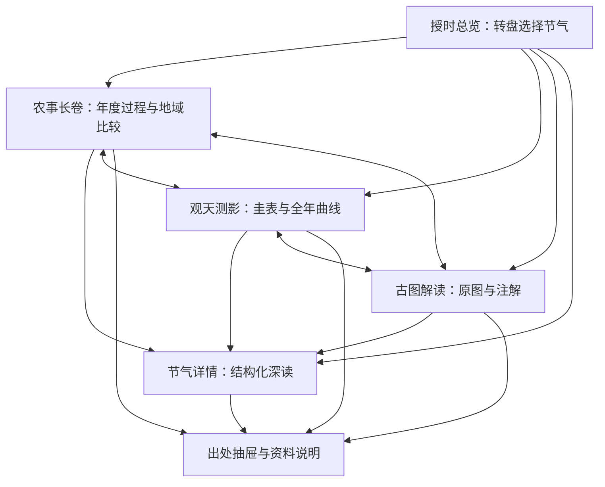

# 《转动的授时图》产品设计方案

版本：v1.2  
日期：2026年10月29日  
用途：后续界面设计、内容整理、编码实现、联调验收与比赛演示的共同依据  
当前阶段：交互原型开发；历史内容继续按资料研究记录核验

> 2026-10-29更新：用户已确认参赛方向。观天测影改以水平式日晷为主要体验，增加真太阳时控制；原八尺竖表模型作为折叠原理参考。详见[日晷设计变更说明](产品设计变更_日晷.md)。此变更优先于本文中尚保留的前期圭表描述。

> 2026-10-29交互更新：总览、农事与日晷共用连续年角；加入节气滚动条、转盘惯性与弹簧吸附、季相氛围、十组候象动画、农谚农事双向联动示例与阅读转场。候名为团队初稿，农谚示例明确待核对。详见[交互与动效实现说明](交互与动效_实现说明.md)。此更新优先于后文原型阶段的功能占位描述。

> **路线基线：以授时转盘为核心入口，通过“授时总览、农事长卷、观天测影、古图解读”四个主题视图，呈现节气、物候、农事与日影之间的联系。四个视图共享同一个节气选择，组成一件连续、可探索的作品。**

## 0. 如何使用这份文档

本文承接《〈转动的授时图〉需求分析报告 (1).md》，将讨论中的构想整理为可以执行的产品设计路线。原需求报告属于前期访谈记录，本文已纳入后续实施所需的主要约束，可以独立阅读。

后续开发按以下顺序理解需求：用户最新明确要求 → 本文的产品设计基线 → 原需求报告。遇到本文尚未确定的史料、观测参数或赛事条件，先核验再填写，不凭开发者的理解补成事实。

本文中的内容分为三种状态：

| 状态 | 含义 | 后续处理 |
| --- | --- | --- |
| 路线已确认 | 用户已经同意以转盘为核心、多个主题板块联动的成品形式，并要求形成后续开发依据 | 持续遵守；改动整体路线需重新讨论 |
| 设计基线 | 为使路线具体可执行，本文确定的页面、交互、视觉和范围选择 | 后续默认按此实现，可在原型测试后调整并更新本文 |
| 资料待核验 | 古图底本、农事证据、历史测影记录、具体坐标、赛事规则等 | 核验通过后使用；不得把占位内容当成正式资料 |

本文定义产品应当如何工作，不宣称全部内容资料已经搜集完成。文中的内容数量是建设目标，不能用于倒逼团队编造条目。

## 1. 产品定位与表达主线

### 1.1 产品是什么

《转动的授时图》是一件面向电脑浏览器的交互式信息可视化作品。以传统授时图为文化切入点，将二十四节气作为共同的时间索引，连接七十二候、具体地域的农事过程与正午日影变化。

一句话定位：**转动一年，看天时如何连接物候与农事。**

产品的主要体验是探索、比较和理解。用户可以随意选择节气，也可以沿着某一种作物、某一条影长曲线或一张古图逐步深入。

### 1.2 作品要回答的四个问题

1. **此时在一年中的什么位置？** 通过授时总览，理解节气与三候的次序和当前状态。
2. **农事如何沿一年连续展开？** 通过农事长卷，观察具体作物、具体地区的农事安排及其差异。
3. **节气与太阳、日影有什么关系？** 通过观天测影，理解年度变化和关键节点。
4. **古人如何把一年组织成一张图？** 通过古图解读，认识有据可查的图文结构与读图方法。

### 1.3 用户完成探索后的预期收获

- 能在二十四节气的全年结构中找到一个节气，知道它前后相邻的节气与所属三候。
- 能描述至少一个有文献依据的作物农事过程，理解其地域和时段限制。
- 能在本作品指定的观测地点条件下，解释两至正午影长的差异。
- 能指出现代交互图与历史原图之间的对应，以及现代新增的解释设计。
- 知道在哪里查看证据，能区分历史记述、现代释义和理论计算。

## 2. 用户、场景与成品气质

### 2.1 主要用户

对节气名称有印象，但对历法、物候和传统农事缺少系统认识的大学生及一般观众。默认用户没有天文学基础，也不会先阅读操作说明。

### 2.2 三种使用场景

| 场景 | 用户的行为 | 产品的支持 |
| --- | --- | --- |
| 30秒初次接触 | 看首屏、尝试转盘、选中一个节气 | 首屏可直接操作，反馈明确，出现简短提示 |
| 3—5分钟探索 | 切换板块、比较南北农事、观察日影 | 共用节气上下文，关键图表容易读懂 |
| 8分钟左右讲解 | 按预先准备的路径展示完整作品 | 页面稳定、资料可追溯、跳转与返回连贯 |

这里的讲解时长是内部设计目标，正式提交与答辩限制需依据当届规则核验。

### 2.3 成品气质

整体像一本以转盘为目录、可以进入不同篇章的交互古籍。古籍质感服务于内容阅读，现代排版负责组织层次，图表负责展示关系。

首屏有鲜明的圆形视觉记忆；深入之后，每个篇章都有可探索的问题和有效的交互。

## 3. 产品结构与导航

### 3.1 页面结构

| 页面或组件 | 核心职责 | 是否进入主导航 |
| --- | --- | --- |
| 授时总览 | 选择节气，查看摘要，进入主题视图 | 是，默认首页 |
| 农事长卷 | 展示全年农事时序、作物过程、地域比较 | 是 |
| 观天测影 | 展示圭表、全年影长、关键节点与模型说明 | 是 |
| 古图解读 | 浏览原图，阅读局部注解，对照现代设计 | 是 |
| 节气详情 | 承载24个节气的结构化深入内容 | 否，由相关入口进入 |
| 出处抽屉 | 就近查看某条内容的证据与版本 | 否，浮层组件 |
| 资料与说明 | 汇总书目、图像来源、方法与制作说明 | 否，由固定次级入口进入 |

节气详情共用同一套页面结构。首页、农事长卷与其他板块引用相同内容记录，避免各自维护一套重复资料。

### 3.2 全局导航

- 左侧：作品名，点击返回授时总览并保留当前节气。
- 中部：授时总览 / 农事长卷 / 观天测影 / 古图解读。
- 右侧：资料与说明、简短帮助。
- 内容区上方保留紧凑的“当前节气条”：节气名、上一节气、下一节气、选择节气、回到今日。

总览已经有大转盘，不再额外显示一套完整的小转盘。其他主题视图使用紧凑节气条，避免每个页面重复占据大面积空间。

### 3.3 导航关系

## 4. 核心体验与完整用户旅程

### 4.1 首次进入

1. 直接进入授时总览，不设置强制开场动画或必须点击的封面。
2. 有可靠的当年交节数据时，定位到今天所处的节气区间。
3. 显示一句操作提示：“拖动转盘，查看一年中的天时与农事。”提示可关闭，第一次完成操作后淡出。
4. 用户可以拖动，也可以点击节气名称或使用前后按钮。
5. 当前节气卡片与圭表预览立即给予反馈。

### 4.2 从一个节气展开探索

以用户选择“芒种”为例，以下是交互示意，具体农事内容须由核验后的资料提供：

1. 总览聚焦芒种，显示三候、节气摘要和有出处的南北农事摘要。
2. 点击“在农事长卷中查看”，进入长卷，时间指针停在芒种。
3. 选择一条作物轨道，查看其前后农事阶段与来源。
4. 切换到观天测影，仍停在芒种，观察日影和年度曲线中的位置。
5. 点击夏至，比较日影变化；此时全局节气更新为夏至。
6. 首次进入古图解读时保留夏至；有已核验的对应注解时可定位该注解，没有时展示通用读图内容。已经读过古图时恢复原阅读位置，由用户点击“定位当前节气相关内容”主动跳转。
7. 返回总览，转盘停在夏至。

### 4.3 从一个问题展开探索

- “这条作物轨道一年经历什么？”→ 农事长卷 → 选轨道 → 逐阶段查看。
- “为什么影长会变化？”→ 观天测影 → 观察两至 → 展开几何关系与模型说明。
- “这张古图应该从哪里读起？”→ 古图解读 → 跟随读图步骤 → 查看原图局部。

用户可以随时切换探索路径，各板块不要求按固定顺序解锁。

## 5. 全局状态与联动规则

这一节是后续编码必须遵守的行为约定。

### 5.1 共享状态

| 状态 | 默认值或来源 | 影响范围 |
| --- | --- | --- |
| 当前已选节气 | 深层链接指定优先，否则尝试定位今天 | 四个主题视图、节气详情 |
| 展示周期起始年 | 链接指定的受支持周期，否则由今天所在周期确定 | 公历日期展示、周期范围与今日定位 |
| 农事区域筛选 | 南北并列 | 总览、农事长卷、详情中的农事区域 |
| 观测地点 | 核验后的阳城位置 | 全部日影、太阳高度与昼夜数据 |
| 表高 | 八尺 | 全部影长模型展示 |

首版不提供观测地点自由切换。农事的南北筛选不会改变阳城观测地点，页面必须让两者的含义清楚可辨。

### 5.2 板块内部状态

作物选择、长卷展开项、古图缩放位置、已打开注解和阅读滚动位置属于板块内部状态。正常切换主导航时尽量保留。

选择新节气会移动相应时间指针，不自动清空用户已经选中的作物或关闭古图注解。只有用户主动执行“重置视图”才回到该板块初始状态。古图已经有阅读状态时，主导航进入应优先恢复该状态；定位新节气相关内容由明确按钮触发。

### 5.3 三类交互的差别

| 操作 | 行为 |
| --- | --- |
| 悬停 | 只显示局部提示与高亮，不修改全局节气 |
| 拖动转盘 | 连续更新转盘和日影视觉预览；进入新候选节气时更新摘要预览 |
| 松开或点击节气 | 吸附/定位到目标节气，提交一次全局选择并更新其他板块 |

拖动过程有独立的预览状态。取消拖动应恢复原选择。拖动后的释放不得被再次识别为点击，避免意外跳转。

日影预览若采用连续角度计算，拖动时的中间读数标识为预览；稳定后的摘要与读数对应所选节气节点。首版不把节气详情的整篇文字随拖动反复加载。

### 5.4 跳转、返回和刷新

- 切换主导航保留当前节气和适用的农事区域筛选。
- 从某条农事进入详情，应记录来源页面、节气、周期、筛选、事件、作物和阅读位置的快照。
- “返回来源页面”恢复这份快照，包括进入详情前的节气。即使用户在详情内改选过节气，点击此按钮也恢复原选择；按钮可写成“返回农事长卷·芒种”，使结果可预期。
- 若用户希望沿用详情内的新节气，直接点击主导航进入其他视图，继续使用当前选择。
- 已选节气和必要的筛选参数应可写入页面地址，刷新后恢复。
- 浏览器后退恢复相应历史页面与选择；拖动期间不产生大量浏览器历史记录。
- 连续选择节气用于更新当前地址状态；主导航跳转和进入详情形成可后退的页面记录。
- 直接打开详情或主题视图时可以独立加载，不能依赖用户先访问首页。
- 详情没有有效来源快照时，显示“返回授时总览”，并保留当前节气，不盲目返回浏览历史中的外部页面。
- 没有有效链接参数时才执行今日定位。
- 无效节气参数应显示简短提示并回退到有效选择，不能出现空白页。

### 5.5 展示周期与跨年规则

- 周期年份定义为该轮立春所在的公历年份。例如“2026周期”从2026年立春开始，到2027年立春之前结束。
- 该周期中的小寒、大寒显示2027年的日期。页面在日期区域清楚标注“2026立春—2027立春”。
- 自动定位今天时，立春以前归入上一周期；例如2027年1月初位于2026周期，不能因此显示2028年的小寒。
- 首版的手动节气选择是在当前展示周期内循环。大寒后选择“下一节气”回到同一周期的立春，不自动切换周期年份；边界处给出“回到本周期立春”的提示。
- 首版不设置独立年份浏览器。“回到今日”同时更新周期和节气；深层链接可以指定受支持周期。
- 理论影长与物候顺序是周期性解释；日期标签是该展示周期的现代定位。两者使用一致的周期说明。

### 5.6 今日定位口径

- 以 Asia/Shanghai 时区的实际时刻判断。
- “今天所处节气”指最近一次已到达的交节时刻至下一次交节时刻之间的区间。
- 页面需区分“交节时刻”与“所处区间”，避免把节气只理解成某一天。
- 数据需包含跨年相邻节点，正确处理1月初、年底及交节当天。
- 首版日期资料覆盖2025—2028四个完整立春周期，并包含2029年小寒、大寒及立春边界。这样可覆盖2026年1月的前一周期，也支持2027年的制作与展示。完整记录来源，允许后续扩充。
- 不得仅凭每年固定的月日判断交节；“大致日期”只用于一般说明。
- 若今天所在周期超出资料范围或日期数据加载失败，明确说明今日定位暂不可用，显示最近受支持周期的立春，仍可手动探索，不假装准确定位。

## 6. 页面一：授时总览

### 6.1 页面目的

让用户一眼识别作品主题，立即选择节气，在同一个画面中获得天文、物候、农事的简明联系，并找到深入入口。

### 6.2 桌面布局

- 顶部：全局导航。
- 主区左侧约六成：大转盘与简短操作提示。
- 主区右侧约四成：当前节气卡片、南北农事摘要、圭表预览。
- 页面下方：与当前节气相关的三个主题入口。中等尺寸屏幕允许轻量纵向滚动。

首屏优先保证转盘、当前节气、农事摘要和至少一个明显深入入口可见。圭表预览根据高度调整尺寸，不能挤压正文。

### 6.3 转盘结构

转盘采用三层环的现代组织方式，具体视觉如下。此结构是本作品的设计，不预设为古图原始结构。

| 区域 | 常驻内容 | 选择后内容 |
| --- | --- | --- |
| 外环 | 二十四节气名称、四季分组、当前选择标记 | 当前节气明显高亮 |
| 中环 | 七十二候的三分结构与轻量刻度 | 当前节气的三候名称高亮，可点开短释义 |
| 内环 | 太阳黄经的结构刻度与关键节点 | 当前黄经数值、两至两分位置提示 |
| 圆心 | 当前节气名称、简短释义或对应线描 | 节气详情入口 |

完整72候名称不强制同时铺满圆环。默认只展开当前三候，其他候保留结构标记；放大或专门阅读时再显示更多文字。

公历日期、昼夜长度和完整农事文本放在当前节气面板。它们持续可见，但不全部挤入圆环。

展示次序以立春开篇，沿顺时针依次排列24节气，循环回到立春。读图采用固定在上方的选择标记；转盘旋转至目标节气对齐选择标记。立春开篇属于叙事排序，不表示黄经从立春起算。

节气文字应保持正常阅读方向，避免转动后出现倒置文字。按钮、候标记和详情入口的点击不触发拖动。

### 6.4 当前节气卡片

固定模板：

1. 节气名称、简明释义。
2. 当前展示周期对应的公历交节日期及年份；没有精确资料时标为大致日期。
3. 初候、二候、三候名称，各自可展开一句解释。
4. 太阳黄经，以及带“阳城模型”标识的昼夜长度。
5. 北方案例、南方案例的农事摘要，条目附具体地域标签。
6. 农谚一条，可展开更多；附出处入口。
7. “阅读本节气”“查看全年农事”“观察此时日影”三个去向。

### 6.5 南北摘要规则

- 默认并列展示，可以切为只看北方或只看南方。
- 每侧优先显示1条最能代表所选资料的记录，可展开至2条。
- “南方”“北方”下方显示案例实际地域，防止用户把案例理解成全国统一情形。
- 摘要取自统一农事资料，点击可以定位农事长卷的同一条记录。
- 当前节气暂无已核验案例时，显示“该时段暂无经核验的案例”，并提供前后相关记录入口。

内容整理以24节气的南北摘要均有可核验材料为覆盖目标。跨多个节气的同一阶段可以合理复用同一来源，不必凑成48条互不相同的事实。发现资料空缺时保留缺省状态并记录为内容缺口，不能仅因页面能显示占位就判定内容完成；确实无法补足时，在定稿中明确实际覆盖范围。

### 6.6 日晷预览

显示水平式日晷的正午预览、真太阳时午正与“进入观天测影”入口。拖动转盘时同步改变季节与影端，不把日晷投影标成八尺竖表影长。

总览使用同一日晷组件的简化形态。完整时刻控制、季节轨迹、原理和历史记录留在观天测影视图。

## 7. 页面二：农事长卷

### 7.1 页面目的

让用户看见农事在全年中的连续安排，以及有文献支撑的地域差异。这是本作品补足内容厚度的重点板块。

### 7.2 主要图形

采用“全年节气时间轴 × 作物地域轨道”的长卷结构：

- 横向：从立春到大寒的24节气索引。
- 纵向：每一行是一个“具体地区 × 具体作物或农事过程”案例。
- 轨道上的点或带：已核验的农事事件或持续阶段。
- 当前节气：贯穿轨道的时间指针。
- 南北分组：使用分组标题、地域文字和辅助色。

默认全年尽量完整可见，至少保证节气次序和轨道概览清楚。详细标签通过选中或展开显示，不让用户必须横向滚动才能理解整体。

横轴是节气顺序索引，不是等天数的公历刻度；相同格宽服务于比较。持续范围的精度应与来源相符。

### 7.3 两种阅读方式

**按节气读：** 点击节气列，查看该时段各条轨道中的农事；旁边出现南北案例对比。

**按作物读：** 点击轨道标题，突出该案例的全年阶段，侧栏依次说明播种、管理、收获等有据可查的活动。实际阶段由史料决定，不套用统一流程强行补齐。

两种阅读方式可以叠加：选中某一轨道后，再选节气，轨道选择继续保留。

### 7.4 事件详情

选中事件后，在侧栏或下方显示：

- 作物与阶段名称。
- 具体地区、资料时期、适用限制。
- 简明说明：此时做什么，文献为何这样描述。
- 原始时间措辞，如某月、某候、某时段。
- 节气映射方式：直接记载 / 约对应范围 / 无法精确对应。
- 来源入口、相关节气详情入口。

原文只记宽泛季节时，用范围带和“约”提示；无法合理对应节气的资料放在案例说明中，不强塞到某一格。

点击农事事件只选中该事件并展开解释，不自动改变全局节气。改变全局节气应通过节气列、节气条或明确的“查看某节气”操作完成。事件跨多个节气时提供可选择的关联节气；仅有一个明确对应时可直接进入该节气详情；无法精确对应时不提供虚构的节气详情入口，仍可查看案例与出处。

### 7.5 比较设计

至少提供一组资料条件适合比较的南北案例。优先比较有意义的时间与过程差异，例如相近作物在不同地域的记录，或同一节气下不同农业任务的并存。

解释比较成立的前提：地区、时期和资料类型。不同年代、不同体裁的资料不能悄悄拼成同一年实测农事历。

不以条目数量表现“农忙程度”，除非另外找到可支持该指标的数据。首版不绘制缺乏依据的热力图、产量排名或劳动强度指数。

### 7.6 首版内容规模

- 4条经过核验的案例轨道，南北各至少1条，目标为各2条。
- 每条目标6—10个有来源的事件或阶段；数量服从资料实际情况。
- 至少一组可以说明比较意义的南北案例。
- 案例应能解释前后农事联系；资料中存在的空档可以保留。
- 内容条件成熟后扩充到6条轨道，保持页面可读性。

具体地区和作物在资料摸底后确定。选题条件是“有足够完整且可追溯的史料”，而非先定好漂亮的轨道再寻找填充材料。

### 7.7 用户应该能完成的操作

选节气、筛选南北、选择轨道、查看事件、查看出处、跳转对应节气详情、恢复全年概览。

## 8. 页面三：观天测影

### 8.1 页面目的

以水平式日晷作为可以观察、比较和解释的主场景，八尺竖表的年度影长作为可展开的原理参考。

本页展示两个相互联系的层面：现代天文模型解释节气节点与日影变化；历史资料提供有出处的观测或计算案例。

### 8.2 页面结构

- 上方：当前节气、日晷类型与演示地点说明。
- 左侧主图：固定比例的晷面、极轴式晷针、时辰刻线、日影与季节影端轨迹。
- 右侧：真太阳时、04:00—20:00时刻控制、播放/暂停、回到午正、太阳高度和理想昼长。
- 下方：两至两分切换按钮，在同一座日晷上比较；切换节气保留时刻。
- 折叠区：八尺竖表全年影长曲线、方法说明和核验后的历史记录。

### 8.3 三组核心交互

1. **沿一日观察：** 操作时刻滑块或播放按钮，观察同一节气下日影的方向与影端。太阳在地平线下时不画直射日影。
2. **比较季节：** 选择春分、夏至、秋分、冬至；保持同一时刻、同一晷面与绘图比例，比较影端位置。水平极轴日晷在同一真太阳时的影线方向不因节气而任意旋转。
3. **逐步理解原理：** 展开读晷说明，理解极轴针、纬度与时线。另行展开八尺竖表曲线，保留原项目解释节气年度变化的能力。

现代节气节点按太阳黄经定义，相邻节点相差15°；春分为0°、夏至为90°、秋分为180°、冬至为270°。这一现代展示口径可核对[香港天文台《二十四节气》](https://www.hko.gov.hk/sc/gts/time/24solarterms.htm)。它是本作品解释天文关系的基准，不等同于对所有历史时期定气方式的复原。

### 8.4 观测与比例规则

以下八尺与影长单位约定用于折叠区的竖表模型。主日晷以晷针垂直高度1归一化，保持几何比例，不将其投影长度标为八尺竖表读数。主日晷使用真太阳时，不直接换算北京时间。

- 地点沿用原需求中的“阳城”，具体历史地理对应、采用坐标和依据需在制作前确定。
- 表高采用八尺，影长使用尺、寸和必要的小数，不擅自换算为某一现代米制长度。
- 正午指当地太阳中天附近的观测定义，不直接写成北京时间12:00。
- 首版采用固定地点的理想几何模型，参数与近似方法公开说明。
- 模型参数以现代原理演示为基准；若未来要复原历史时期，另建经核验的历史参数方案。
- 全年图形使用固定的影长尺度，不能每个节气单独缩放而削弱长短差异。
- 坐标轴、单位、地点和模型类型始终可以查到。
- 连续年度曲线由模型计算，不能画成24个点的装饰性平滑线后称为连续计算结果。
- 默认曲线横轴与农事长卷一致，使用节气/黄经周期；说明它不等于等天数公历轴。

圭表的正午测影原理可参考[国立天文台历计算室《圭表仪》](https://eco2.mtk.nao.ac.jp/koyomi/wiki/B7BDC9BDB5B7.html)。具体比较结论必须限定在本作品采用的地点条件内。

### 8.5 昼夜长度口径

首版使用同一地点下的理想几何昼夜长度，标为“模型值”；方法说明写明是否忽略大气折射、太阳视半径和地形遮挡。不同页面必须使用同一口径。

不能把“春秋分昼夜均分”的理想解释与实际日出日落时刻混为一谈。实际定义及折射等因素会影响可观测昼长，可核对[国立天文台关于春秋分昼夜长度的说明](https://www.nao.ac.jp/faq/a0303.html)。

### 8.6 历史记录对照

优先整理两至两分，最多先展示4个关键节点。只有核验通过的记录进入正式界面。

每条记录至少标注文献与卷页、记录性质、地点、表高、单位、时间条件和适用说明。记录性质要区分实际观测、推算、转引和制度性数值。

满足条件可比时，才展示并列数值与差异解释；条件不一致时，并列说明背景，不计算看似精确的误差百分比。

某个节点没有可靠记录时保留模型对比，明确历史资料尚未收录。资料缺失不影响模型探索功能。

## 9. 页面四：古图解读

### 9.1 页面目的

让用户真正接触作品所借鉴的历史图像，理解原图的阅读方法及其内容组织，并识别本作品的现代解释设计。

### 9.2 内容前提

拟以王祯《农书》中的相关授时图作为研究对象。进入制作前必须确定准确图名、版本、所在卷页、图像来源和可用性。

在没有核对原图前，不预设它具有现代转盘的三层环、南北农事并列、太阳黄经刻度等结构。原图实际呈现什么，就解释什么。

### 9.3 页面结构

- 主区：原图阅读器，支持放大、缩小、拖动、适合窗口、重置。
- 侧栏：当前注解标题、原图局部定位、释读和出处。
- 上方：读图引导 / 自由探索 / 与本作品对照。
- 下方：底本信息、图像来源和必要的文字辨识说明。

### 9.4 三种阅读方式

**读图引导：** 以4—6个核验后的主题步骤讲解原图。每一步高亮真实局部，说明当前在看什么、如何继续阅读。主题数量可依据原图调整。

**自由探索：** 点击有依据的热点查看局部与说明。热点覆盖真实图文，不虚构古图没有的内容。

**与本作品对照：** 将古图局部与现代可视化表达并列，说明哪些内容承接原图，哪些由现代资料补充，哪些是交互与排版设计。

### 9.5 与节气状态的联动

- 当前节气在全局节气条中保留。
- 原图有对应内容并完成核验时，提供“定位当前节气相关内容”。仅首次进入且没有阅读状态时可以自动定位；之后进入优先恢复阅读状态。
- 没有直接对应内容时，继续呈现通用读图，解释本注解涉及的内容范围。
- 某注解涉及一个节气，可点击切换；涉及多个节气时显示可选择的节气集合，不擅自只选一个。
- 用户缩放或拖动原图不会改变全局节气。

### 9.6 文字与图像规则

- 保留原图可辨识的文字形态；释读文字另设清晰排版。
- 识读不确定处明确标注，OCR结果必须人工核对。
- 现代重绘、补色、热点和引导线与原图本体清楚区分。
- 图像加载失败时保留底本信息与文字说明，并提供重试。

## 10. 节气详情与资料出处

### 10.1 节气详情的定位

每个节气有一页结构化深读内容，供四个视图共同进入。页面承担解释与证据整理，不重复搭建第五套主题系统。

### 10.2 固定内容模板

1. **此时在一年中的位置：** 节气含义、前后节气、现代日期说明。
2. **三候怎样描述变化：** 三候名称、短释义、底本、必要的异文与现代说明。
3. **田间发生什么：** 有地域与时期标签的农事案例，链接长卷相同记录。
4. **此时的天文关系：** 当前黄经、阳城模型日影和简明说明，链接完整测影页面。
5. **相关图文与农谚：** 经过核验的原文、释义与图像。
6. **资料说明：** 本页使用的记录、参考书目和不确定性。

页面有章节目录、返回来源页面、前后节气和返回总览。进入时可定位到农事、物候或天文章节。

### 10.3 篇幅基线

每页主体说明以约600—1200字作为首轮编辑目标，按实际解释需要调整；引文、图注与书目另计。24页约1.4万—2.9万字主体说明，用作工作量估算。

不把“每页5000字”作为硬指标。内容厚度主要由四个视图的关系展示、案例过程、证据和用户可完成的探索共同形成。

### 10.4 出处抽屉

点击任意事实条目的出处标记，在当前页面打开侧边抽屉，保持原阅读上下文。

统一显示：条目标题、现代摘要、必要原文、文献名称、作者或责任者、版本、卷页或影印定位、原文时期、地域、可访问的来源、核验状态和适用说明。

外部链接只作为进一步核查入口，正式作品中的基本出处信息在离线环境也能阅读。关闭抽屉后回到原控件位置。

### 10.5 资料与说明页

集中提供底本说明、参考书目、图像与字体来源、模型参数、日期资料来源、现代改编说明，以及制作信息。

这页是证据索引，各内容旁仍保留就近出处入口，用户不必到书目中自行猜测某句话来自哪里。

## 11. 内容建设计划与数据组织

### 11.1 内容规模基线

| 内容单元 | 首版目标 | 完整性要求 |
| --- | --- | --- |
| 节气基础档案 | 24份 | 名称、次序、黄经、日期说明、关联三候完整 |
| 物候条目 | 72条 | 名称、短释义、所属节气、底本完整 |
| 节气深入页面 | 24页 | 使用统一模板，允许不同节气的资料丰富程度不同 |
| 总览农事摘要 | 目标覆盖24节气的南北各至少1条，最多展示2条 | 合理复用跨节气记录；缺口须披露，不另外编造 |
| 农事长卷案例 | 4条轨道，条件成熟扩至6条 | 地域、作物、时期和事件证据可追溯 |
| 农事事件 | 每轨目标6—10个 | 保留原始时间与映射精度，不强求均匀分布 |
| 农谚 | 24—48条整理目标 | 数量服从核验结果；没有可靠出处可以缺省 |
| 天文模型 | 24节气节点＋连续周期曲线 | 与圭表预览、对比图一致 |
| 历史测影记录 | 两至两分优先，最多先做4组 | 可核验、说明是否可比 |
| 古图 | 1个明确底本的完整图像 | 图名、卷页、来源与清晰度满足阅读 |
| 古图解读 | 约4—6个主题 | 与真实局部、文字和来源一一对应 |
| 日期资料 | 2025—2028完整立春周期及2029立春边界 | 交节时刻与时区有来源，周期与自然年区分 |

原报告中的“144条”来自对“每节气两条”的一种解释，并非本轮已确认的固定指标。本方案以可核验覆盖和图表表达为准。

24节气和72候需要完整索引；农事事件不要求覆盖每个时间格。资料不足必须保留边界，不能以页面看起来齐整为由补写历史事实。

### 11.2 统一内容实体

以下是字段设计要求，用于之后的数据建模；本阶段不创建程序文件。

| 实体 | 关键字段 |
| --- | --- |
| 节气 | 稳定ID、名称、排序、季节分组、太阳黄经、简述、三候ID、详情内容关联 |
| 物候 | 稳定ID、名称、所属节气、候序、短释义、原文、底本来源、异文说明 |
| 农事记录 | 稳定ID、南北导航组、具体地区、作物/品种、阶段、原始时间、节气对应范围、映射精度、摘要、原文、资料时期、来源ID、适用限制 |
| 作物地域案例 | 稳定ID、标题、地区、时期范围、作物、关联事件、选题说明、比较条件 |
| 农谚 | 稳定ID、正文、释义、地域、时间对应、来源ID、年代依据 |
| 古图注解 | 稳定ID、底本ID、原图定位范围、标题、释读、关联节气、原文和来源 |
| 历史测影记录 | 稳定ID、节点、数值、单位、表高、地点、记录性质、时间条件、来源ID、可比性说明 |
| 来源 | 稳定ID、文献名称、责任者、成书时期、版本、卷页、影印定位、链接或本地资料位置、访问日期、使用说明 |
| 日期资料 | 公历年份、展示周期起始年、节气ID、交节时刻、原始时区、统一时区、来源、核验信息 |
| 模型配置 | 观测地点、坐标及依据、表高、参数基准、计算方法说明、忽略因素、输出单位 |

来源与内容记录分开维护，一份来源可以支持多条记录，同一条内容通过ID被多个页面引用。

### 11.3 内容生产与核验流程

选定底本与研究样本 → 摘录原文 → 保存来源定位 → 编写现代摘要 → 标注地域与时间精度 → 由另一人核对 → 进入待排版 → 页面验读 → 发布。

资料状态统一为：待搜集、已摘录、待核验、已核验、待修订、暂不采用。

正式界面只使用已核验记录。原型阶段允许占位数据，但必须明确显示“演示占位”，并在发布前统一清除。

### 11.4 内容年代边界

沿用原需求：历史内容研究范围不涉及1911年后的农业实践或民俗演变。

现代整理本、数字影像、学术研究和机构科普可作为查证与释义工具，需区分“现代资料的出版时间”与“所描述历史内容的时期”。现代天文模型和当前日期是解释、交互工具，不冒充历史原始数据。该口径与当届赛事要求的符合性另行核验。

## 12. 科学、历史与表达边界

### 12.1 七十二候

拟以《月令七十二候集解》体系为主要底本，具体版本需核验。全文保持同一底本；其他版本的差异在注解中说明。

物候作为文献中的观察与表达呈现。涉及传统观念的条目，分开写文献原意与现代释义，不暗示全国各地每年必然同步发生。

环上每节气三等分用于结构索引，不代表每候严格对应固定天数或精确黄经。

### 12.2 南北分组

保留原需求以秦岭—淮河作为南北概略分组的口径。它用于导航组织；具体农事以实际地域和文献范围为准，边界附近及特殊气候区的情况另作说明。

首版使用分组文字和案例标签即可，不设置行政区划地图。

### 12.3 时间体系

现代交节时刻、古籍月份记述、传统物候和作物时段分别保留其定义。跨体系对应时说明依据与精度。

立春开篇的展示周期与公历自然年跨年，按第5.5节定义展示周期；不能把下一自然年的小寒、大寒误标成同年较早日期。

### 12.4 模型与历史记录

“模型计算”“文献记述”“历史观测”“现代释义”在界面中使用文字标签区分。历史记录是否属于实测须由原文确定。

模型差异不能直接归因于古人测量不准。地点、单位、表高、参数、时间和记录性质需要先可比。

### 12.5 原图与现代设计

对原图的结构解释必须基于实际底本。现代增加的转动方式、色彩、数据层、南北对比与图表，要在古图对照中说明设计来源。

## 13. 视觉设计路线

### 13.1 基础风格

古籍线描与低对比纸纹提供质感，朱砂、青绿和现代排版建立重点。大面积保持浅色和留白，图表与正文具有清晰对比。

### 13.2 色彩职责

| 用途 | 设计方向 |
| --- | --- |
| 页面背景 | 米白或浅纸色，纹理极轻 |
| 正文与主线条 | 深墨色 |
| 当前节气、选中、主要操作 | 朱砂色 |
| 北方案例 | 赭色系辅助标识 |
| 南方案例 | 青绿色系辅助标识 |
| 次要结构与未选节点 | 淡墨、灰褐 |
| 春夏秋冬分组 | 低饱和季节提示，与南北颜色有明确不同的图例 |

南北比较同时使用文字、位置和标记形状，不能只靠颜色。当前节气的强调色在四个视图中保持一致。

### 13.3 字体与图像

- 作品标题可使用有古意且允许使用的字体。
- 正文、图表数值和按钮使用清晰字体；古籍文字另做释读。
- 正文默认约16像素，主要图表标签约14—16像素；更小字号只用于次要信息且需实屏检查。
- 图像优先使用明确来源的古图、经查证的器物线描、少量作物插图。
- 作物图像辅助辨识，农事阶段和比较关系由图表承担。
- 纸纹不能盖住文字，插画不能代替数据。

### 13.4 页面尺寸与适配

- 首要验证尺寸：1440×900、1366×768、1280×720。
- 转盘随可用空间缩放，主要范围约480—640像素直径，具体由样稿验证。
- 总览优先双栏，主题页根据内容安排主图与解释区。
- 在较矮屏幕上允许纵向滚动，保持导航和主要控制易于找到。
- 小窗口提供合理的收缩或滚动布局，首版不承诺完整手机体验。
- 独立详情页控制正文行宽，避免长行铺满屏幕。

### 13.5 动效

吸附和切换动效以短、清楚为目标，常规约200—400毫秒。转盘拖动跟手，圭表变化与其同步。

文字不频繁飞入飞出，不设置阻塞阅读的长转场。尊重减少动态效果的系统设置。

## 14. 交互细节与异常状态

### 14.1 通用操作

- 所有核心动作可通过点击完成；拖动具有等效的前后节气按钮或选择列表。
- 键盘可聚焦导航、节气选择、图表记录、出处与关闭按钮。
- 悬停提示不遮住主要目标，键盘聚焦也可获得对应信息。
- 图表选中状态同时具有文字与形状反馈。
- 抽屉与对话框可明确关闭，关闭后焦点返回触发控件。
- 不把长说明藏在只能悬停、无法稳定阅读的小提示中。

### 14.2 状态与恢复

| 情况 | 用户看到的反馈 | 恢复方式 |
| --- | --- | --- |
| 初始资料加载 | 主要布局与简短加载状态 | 加载完成自动显示 |
| 某时段农事资料缺失 | “暂无经核验的案例”，与“无农事”区分 | 查看相邻记录或切换案例 |
| 原图加载失败 | 原图占位与底本文字仍可读 | 重试或继续阅读释读 |
| 外部来源不可访问 | 本地保存的书目与定位信息仍可查看 | 用户可按书目自行查阅 |
| 日期年份不受支持 | 明确提示今日定位不可用 | 手动选择节气 |
| 深层链接参数无效 | 简短提示并使用有效默认状态 | 继续操作 |
| 当前古图注解无节气对应 | 保留节气选择，显示该注解实际范围 | 继续读图或选择其他热点 |
| 农事筛选后无记录 | 显示筛选条件和空结果 | 清除筛选 |
| 模型配置缺失或异常 | 显示“模型暂不可用”，不显示伪造数值 | 其他内容仍可探索；开发阶段排查 |

## 15. 实现边界与交付方式

本节约束后续实现，当前不生成代码。

### 15.1 技术路线基线

沿用原报告建议的 Vue 3、Vite、Vue Router 与 SVG/D3 路线，作为后续开工的默认方案。具体依赖版本与计算实现到编码阶段再核对。

采用纯前端静态作品，不设置账号、登录、后端数据库和在线内容管理系统。结构化资料与页面表现分开，长文与图像作为本地资源组织。

### 15.2 运行与发布

- 正常浏览不依赖在线实时接口。
- 关键字体、原图、数据和模型资料纳入作品资源，满足必要的来源与使用要求。
- 可部署于静态托管；深层页面刷新需有明确兼容方案。
- 离线演示包通过明确的本地启动方式运行；是否支持直接双击文件必须实测，不默认承诺。
- 提供简明启动说明和浏览器建议。
- 正式提交形式依据当届要求确定，不把托管网站视为唯一交付。

### 15.3 体验要求

常见笔记本浏览器中转盘拖动和影子联动应流畅，操作后立即有可见反馈。原图与长文允许按需加载，但不能使核心交互卡顿。

性能验收结合实际机器记录，不提前承诺未经实测的帧率和加载时长。

## 16. 范围与优先级

### 16.1 首版完整成品必须具备

- 四个主题视图和统一导航。
- 24节气选择、72候关联与今日定位。
- 转盘拖动、点击、吸附、前后切换和日影联动。
- 总览南北案例并列与区域筛选。
- 农事长卷的4条核验案例轨道、事件详情与至少一组有效比较。
- 圭表、年度模型曲线、两至两分对比、方法说明。
- 有明确底本的古图阅读、局部注解与现代设计对照。
- 24个结构化节气详情。
- 就近出处、统一资料说明、异常状态处理。
- 可稳定运行的展示版本、源资料与启动说明。

历史测影记录以核验结果决定公开数量。模型探索必须完整，不能为了凑齐4条历史记录而使用不可靠资料。

### 16.2 核心完成后再增加

- 自动播放一年，支持暂停并继续手动探索。
- 农事轨道由4条扩至6条。
- 更丰富的物候插图与有证据的关联专题。
- 全站资料搜索；首版已有完整24节气选择列表即可满足快速定位。
- 引导式讲解路线与一键重置演示状态。

### 16.3 本轮不纳入

用户系统、评论收藏、在线编辑后台、实时天气、精细行政地图、自由选址的全球日影模拟、3D漫游、完整移动端、问答聊天助手。

这些功能不承担当前四个核心问题，后续有明确需求再讨论。

## 17. 制作顺序与阶段出口

按可验证成果推进，工期由团队根据实际截止日期排定。以下是先后依赖，不是固定月度排期。

### 阶段A：资料摸底与内容选题

完成：古图底本候选、七十二候底本、阳城定位依据、农事案例候选清单、日期资料来源、参赛条件核验清单。

阶段出口：至少有一条可供完整演示的农事轨道，以及能制作古图阅读样例的原图。若关键资料不足，调整案例范围后再铺开。

### 阶段B：四页低保真原型

完成：总览、长卷、测影、古图四页结构，以及详情、出处抽屉和导航流程。

阶段出口：无需真实程序，也能通过原型走通“选节气—看农事—看日影—读古图—返回”，明确各页面信息主次。

### 阶段C：一条完整探索链

以一个资料充分的节气、一个作物案例和一组古图注解串通四个视图。节气选择、返回恢复、出处展开和模型联动全部成立。

阶段出口：核心产品逻辑可操作、可解释；样例占位与真实资料明确区分。

### 阶段D：全年框架与模型闭环

完成24节气选择与72候关联、日期定位、连续日影曲线、关键节点对比、跨板块状态与深层链接。

阶段出口：全年任意节气都能选择，跨年、刷新、返回均符合第5节规则。

### 阶段E：内容扩充与视觉定稿

完成24节气内容、4条农事轨道、古图注解、出处核验与统一视觉。优先修正真正影响理解的布局和文字。

阶段出口：不存在冒充正式资料的占位内容，图表之间使用一致的数据。

### 阶段F：可用性与展示验证

邀请约5名接近目标用户的人，在少量提示下完成关键任务，记录卡点；核查不同屏幕、浏览器、断网环境和讲解路径。

阶段出口：达到第19节的关键验收条件，并能完成一次连续、稳定的作品讲解。

### 阶段G：交付整理

准备作品包、源文件、资料表、设计说明、模型说明、启动说明与演示录屏；按当届正式规则调整材料。

## 18. 团队协作方式

团队人数待实际安排确认，不以原报告中某个技术理由提及的人数作为事实。可以按以下工作包分配，每人可兼任多个角色：

| 工作包 | 主要成果 | 依赖关系 |
| --- | --- | --- |
| 产品与叙事统筹 | 文档、页面流程、范围控制、讲解路线 | 贯穿全部阶段 |
| 视觉与交互设计 | 页面样稿、图表样式、图标与动效规范 | 先基于低保真结构 |
| 节气与物候内容 | 24档案、72候与底本说明 | 统一资料模板 |
| 农事研究与核验 | 作物地域案例、时间映射、原文证据 | 先完成资料摸底 |
| 天文与古图研究 | 模型方法、参数说明、古图注解 | 需要独立核验 |
| 前端实现与联调 | 页面、状态、图表、运行包 | 按阶段C开始 |
| 验证与材料整理 | 用户测试、资料检查、录屏与提交包 | 随阶段推进，最后集中验收 |

团队共用内容ID、来源索引和同一份版本化产品文档。产品路线调整时同步修改文档，避免设计稿、资料表和程序各自漂移。

## 19. 验收标准

### 19.1 核心用户任务

| 编号 | 验收任务 | 通过条件 |
| --- | --- | --- |
| U1 | 首次打开并找到指定节气 | 目标用户无需口头教学，约30秒内完成 |
| U2 | 查看所选节气的南北案例 | 两次操作以内到达并列内容，可识别实际地域 |
| U3 | 总览→长卷→测影→古图→总览 | 当前节气连续保留，允许用户明确改选 |
| U4 | 追踪一个作物案例 | 能看清已有依据的阶段次序，点击事件可查看证据 |
| U5 | 比较两至日影 | 图形尺度一致，用户能解释本地点条件下的长短差异 |
| U6 | 阅读古图 | 能放大真实局部、读注解、区分原图与现代设计 |
| U7 | 查看事实出处 | 能从就近入口定位到文献与卷页/影印位置 |
| U8 | 从事件进入详情后返回 | 恢复长卷选择和阅读位置 |

### 19.2 数据与模型一致性

- 24节气次序、黄经和72候归属经校对。
- 首页摘要、长卷、详情引用同一条农事记录时内容一致。
- 同一节气、同一模型条件下，各处影长和昼夜读数一致。
- 年度曲线与单点圭表使用相同模型参数。
- 两至两分对比图共用尺度，图形变化与数值一致。
- 今日定位核查交节前后、1月初、年底和不支持年份的行为。
- 按立春开篇展示时，小寒、大寒的年份归属正确。
- 来源缺失、地域不明和时间映射不明的条目不会以确定事实发布。
- 24节气南北摘要的实际覆盖经过逐项检查；未解决的内容缺口在定稿中明确列出，不用随机重复或无出处文字掩盖。

### 19.3 界面与运行

- 三个首要屏幕尺寸均可完成核心任务，无主要控件遮挡和文字倒置。
- 拖动、点击、悬停相互不误触。
- 浏览器后退、刷新和直接打开深层页面可用。
- 无网络时，关键图像、字体、正文、模型与基本出处仍可使用。
- 异常状态可以恢复，不出现无说明白屏。
- 能按准备好的讲解路线连续展示，无需临时修改程序或手工修复状态。

### 19.4 测试方式

开发阶段针对日期边界、节气/角度对应、状态恢复和模型一致性进行必要的逻辑验证。视觉、读图、拖动体验和讲解流程通过实际浏览器检查与用户试用完成。

不把“页面可以打开”当成完成，也不为每一段静态文字单独编写测试。验证围绕关键行为、数据可靠性和理解效果展开。

## 20. 展示叙事与材料路线

建议准备约8分钟的内部讲解版本，为现场操作和提问留余地。该安排不代表已经核实正式时限。

| 环节 | 参考时长 | 展示重点 |
| --- | --- | --- |
| 提出问题与展示首屏 | 约1分钟 | 节气如何连接天时与农事，展示转盘 |
| 选择一个节气 | 约1分钟 | 三候、农事摘要与日影同步 |
| 展开农事长卷 | 约2分钟 | 一条作物过程、一组地域比较、就近出处 |
| 进入观天测影 | 约1.5分钟 | 全年曲线、关键节点、模型与记录的区别 |
| 进入古图解读 | 约1.5分钟 | 实际原图、局部释读、现代转译 |
| 说明方法与回到总览 | 约1分钟 | 数据核验、表达方法、整体联动 |

演示选择资料最充分的路径，不要求使用芒种，也不只依赖一个节气能正常运行。

材料围绕同一套证据组织：产品问题、目标用户、内容研究、可视化编码、交互逻辑、模型方法、验证结果与实际作品。

## 21. 待核验事项与变更记录

### 21.1 开工前优先核验

| 事项 | 原因 | 未核验时的处理 |
| --- | --- | --- |
| 当届主题、小类与提交要求 | 用户于2026-10-29确认参赛方向 | 方向不再作为开发阻断项；具体通知文本待团队归档 |
| 当届AI工具及使用说明要求 | 原报告有待核验表述 | 不把原报告中的名单或限制当成现行规则 |
| 原图底本、图名、卷页与使用来源 | 决定古图解读的真实内容 | 先定义阅读器与注解模板，不编造热点 |
| 七十二候采用版本 | 保证全文一致 | 保留拟用体系，不混用多个版本 |
| 阳城对应位置与坐标 | 决定全部地点相关读数 | 原型标明参数待定，正式展示前解决 |
| 四条农事案例的资料完整度 | 决定长卷内容是否成立 | 调整案例选择，不补造阶段 |
| 历史影长记录及可比性 | 决定对照是否有效 | 仅展示核验通过的记录 |
| 日期来源与跨年覆盖 | 决定今日定位准确性 | 禁用不可靠的自动定位 |

上述赛事事项本轮未重新核验。原需求报告关于2027年主题、AI名单、地图或时限的文字属于前期记录，本文不将其升级为确定事实。

### 21.2 相对原需求报告的设计调整

| 项目 | 本方案的处理 |
| --- | --- |
| 原先以转盘与辅助圭表为主要结构 | 扩展为四个主题视图，转盘保持核心入口 |
| 农事主要按节气展示条目 | 增加全年作物地域轨道与阶段过程，复用原有记录 |
| 圭表主要展示影子伸缩 | 增加全年曲线、关键节点对比和模型解释 |
| 古图主要作为视觉参考 | 增加经底本核验的古图阅读与现代设计对照 |
| 大量信息计划常驻环上 | 圆环保留结构概览，日期和天文读数进入当前面板 |
| 详情篇幅接近说明书，字数未定 | 改为结构化深读模板，约600—1200字作为首轮编辑目标 |
| 每节气两条与144条估算含义不明 | 明确摘要、事件与农谚分别管理，数量服从来源 |

### 21.3 后续变更要求

变更记录至少写明日期、变更内容、原因、影响页面与内容数据。影响四视图架构、核心叙事或科学口径的调整先讨论；按钮位置、间距和一般文案可在原型与测试中正常优化。

| 版本 | 日期 | 变更 |
| --- | --- | --- |
| v1.0 | 2026-10-28 | 建立四主题联动的产品路线，明确内容规模、页面交互、核验边界、实施阶段与验收标准 |
| v1.1 | 2026-10-29 | 记录用户确认参赛方向；用水平式日晷取代主测影及四小图对照，新增真太阳时、日行播放和季节轨迹，竖表曲线改为折叠参考 |

## 22. 给后续开发的接续说明

1. 先阅读本文，确认本轮任务处于哪一个制作阶段；原需求报告可用时作为前期访谈记录对照，不依赖其才能理解本方案。
2. 当前文档本身不代表用户已要求立即开始编码；本轮仅形成产品设计。
3. 开始实现后，优先跑通一条跨四个视图的完整探索链，再扩充全年内容和精修视觉。
4. 全局节气、农事筛选、出处记录与模型参数保持统一；禁止每页各算一套、各写一套。
5. 内容缺失使用明确状态；未核验资料、随意生成的农谚与历史数值不能冒充正式内容。
6. 原图结构由底本决定，页面功能由本方案决定，两者在对照中清楚说明。
7. 用第19节验收结果判断完成程度，并同步更新本文中的实际决定。

后续工作的核心方向始终是：让用户围绕同一个节气，在全年农事、天文原理与历史图像之间连贯探索。
