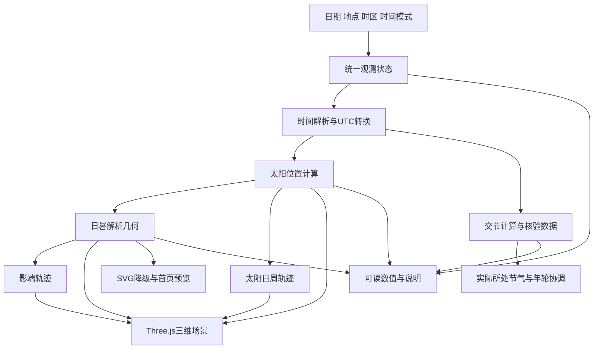

# 《转动的授时图》三维日晷与天文计算模块详细实施策划书

版本：v1.0｜日期：2026年11月10日｜性质：新增功能实施提案

适用项目：当前目录下的《转动的授时图》Vue 网站。本文依据实际代码、已有产品方案和官方技术资料编写；本次交付为策划书，文中“拟新增”“验收目标”均不表示功能已经开发完成。

## 一、项目结论与建设目标

本次将现有“观天测影”升级为一个可交互的三维日晷实验场：用户选择日期、地点与时刻，观察太阳在当地天空的位置，旋转视角理解晷针、光线和影子的空间关系，再通过节气切换理解一年中的变化。

推荐的实施路线是：**延续水平式日晷，使用 Three.js 实现空间展示；建立统一的日期、地点和天文计算模块；用解析几何计算日影，再由三维场景呈现；通过实际交节时刻与现有节气年轮联动。**

### 1.1 最终要让用户看懂什么

1. 一天中太阳的位置如何变化，影子为什么沿不同方向移动。
2. 同一个地点、同一个真太阳时，为什么换季后影端位置发生变化。
3. 改变地点后，太阳高度、日周轨迹、晷针倾角和晷面时线为什么不同。
4. 日晷读出的真太阳时为什么与北京时间或其他当地钟表时间不同。
5. 二十四节气如何由太阳黄经确定，交节这个全球共同的瞬间在当地对应什么太阳与日影状态。

### 1.2 作品的展示价值

形成“节气选择 → 天文位置 → 入射光线 → 几何投影 → 当地日影 → 解释说明”的完整体验。评委能直接操作参数、看见因果关系，并查看计算口径与核验记录。

现代数字模型的教学设计与历史文化内容分别标明来源。器物造型可以有传统质感，但在没有考据资料前，不将其命名为某件历史日晷的精确复原。

## 二、现有项目基础与本次增量

### 2.1 已核实的项目现状

| 项目 | 当前状态 | 对本次建设的意义 |
| --- | --- | --- |
| 工程 | Vue 3.5.44、Vue Router、Vite 8.3.5、JavaScript | 直接扩展当前工程 |
| 页面入口 | `/sky` 对应 `SundialView.vue` | 在现有篇章内升级 |
| 日晷展示 | SVG 固定斜投影，具有立体外观 | 新增真正可旋转的三维空间 |
| 日晷类型 | 水平式、极轴式晷针、非等分时线 | 继续采用，减少理解与迁移成本 |
| 时间操作 | 真太阳时04:00—20:00、5分钟步进、播放、回到午正 | 保留熟悉的比较体验，增加完整日期时间输入 |
| 季节比较 | 两至两分、三条晷针影端轨迹 | 新增天空太阳轨迹并区分图例 |
| 算法 | 35°N、黄赤交角23.44°的理想几何 | 保留作教学参考，新建按日期地点计算的模块 |
| 交节数据 | `SOLAR_TERM_TIMES` 为空 | 需要新增计算、权威校验和数据缓存 |
| 日期与地点 | 尚无完整日期、经纬度、时区输入 | 本轮主要增量之一 |
| 首页日晷 | 固定朝向的轻量预览，点击进入测影 | 保持入口方式，升级共享数据 |
| 全年曲线 | 八尺竖表理想影长，与极轴日晷分开 | 保持模型和单位区分，补充地点联动 |

已阅读的本地依据包括《转动的授时图》产品设计方案、日晷设计变更、候名环与日影环设计变更、现有界面设计规范以及上述实现文件。已有文档中的历史测试记录不作为本次新增功能已验证的证据。

### 2.2 本轮需求覆盖的旧约束

旧方案曾限制固定演示地点、没有独立年份选择。本次用户明确要求输入日期和地点，因此本提案将这两项扩展为正式功能。

保留已有整体产品结构、完整七十二候年轮、节气居中、三候位于−5°／0°／+5°、纸墨风格以及各篇章的联动关系。

### 2.3 建设范围与优先级

| 优先级 | 内容 | 交付要求 |
| --- | --- | --- |
| P0 必须完成 | 可旋转三维日晷、基本材质光照、视角预设 | 真正可从俯视、侧视和斜视观察 |
| P0 必须完成 | 日期、地点、时区、当地钟表时间输入 | 输入能驱动实际太阳与日影计算 |
| P0 必须完成 | 太阳位置、当天日周轨迹、晷针解析影 | 三者使用同一计算结果 |
| P0 必须完成 | 交节时刻、当前所处节气、跳转交节 | 有独立核验与准确的时间口径 |
| P0 必须完成 | 一日播放、午正、两至两分比较 | 保留同一真太阳时比较功能 |
| P0 必须完成 | 首页与观天测影的数据联动、二维降级 | 不出现同一状态不同读数 |
| P1 比赛增强 | 原理解说模式、季节轨迹叠加、预设演示路线 | 在基础功能稳定后完成 |
| P1 比赛增强 | 截图或观测记录导出、地点比较 | 标明日期地点、单位与算法版本 |
| P2 后续拓展 | 赤道式日晷、固定器物迁移实验、全球更广日期范围 | 独立阶段，不挤占核心验收 |
| 暂不纳入 | 实时天气遮挡、建筑地形遮挡、历史器物考古级复原、VR/AR | 当前用户目标不依赖这些功能 |

P0 是完整的第一版：必须同时具备三维展示、真实输入、交节计算和日影联动，不能只完成一个能旋转的模型就宣布上线。

## 三、用户场景与完整使用流程

### 3.1 自由观测：我所在的地方，今天的日影怎样变化

1. 进入“观天测影”，显示当前地点、日期和时间口径。
2. 选择城市，或输入经纬度、时区。
3. 选择日期和当地钟表时间。
4. 画面同步更新太阳、日晷照明、影线、影端和数据读数。
5. 拖动时间滑块，看太阳和日影走过一天。
6. 切换俯视观察时线，切换侧视观察太阳高度与晷针倾角。
7. 打开“显示光线”，看从太阳方向经晷针尖端延伸到晷面的投影关系。

### 3.2 节气比较：同一时刻为什么冬夏影子不同

1. 切换到“按节气比较”。
2. 固定地点与真太阳时，例如10:00。
3. 依次选择夏至、春分、冬至。
4. 保持晷面尺寸、晷针长度、镜头尺度一致，观察太阳高度及影端变化。
5. 显示一句解释：“在同一地点、同一真太阳时，理想极轴日晷的时线方向相同，季节主要改变影端位置。”
6. 若需要看节气发生的一刻，再单独点击“查看交节瞬间”。

“选择夏至作比较”和“跳转夏至交节瞬间”是两个操作：前者保留比较时刻，后者精确跳到计算出来的交节时间，可能落在夜间。

### 3.3 交节观测：节气发生时，当地一定有太阳吗

1. 打开当前节气卡，查看交节时间及其时区。
2. 点击“查看交节瞬间”。
3. 用同一个 UTC 时刻计算所选地点的太阳高度和日影。
4. 若太阳在当地地平线下，显示“交节发生时当地处于夜间，没有直射日影”。
5. 提供“查看交节当天午正”按钮，作为另一个明确的观测时刻。
6. 切换地点并保持同一 UTC 瞬间，观察不同地点的昼夜与日影差异。

### 3.4 首次打开与恢复规则

恢复优先级：有效分享地址 → 本次会话中的观测状态 → 首次访问默认值。

提案默认值：真实观测模式使用北京城市参考点、`Asia/Shanghai`、访问当日的当地午正；页面明确写“今日午正演示”，另提供“此刻”按钮。这样既能让初次进入的用户看见有效日影，也不会将演示时间误认为当前实际时间。城市参考点的精确坐标须在开发时核验并记录来源。

从首页某一节气进入时，优先恢复该节气的比较上下文，真太阳时沿用已保存的值，无历史值时使用原型的10:00。旧35°N理想模型放入“原理参考”，不补造一个经度后当作真实地点。

## 四、页面布局与交互设计

### 4.1 桌面页面结构

```text
第三篇 · 观天测影                    说明 / 重置
一晷日影，读一日时光。

[按日期观测] [按节气比较]
[地点] [日期] [当地时间] [时区] [此刻] [当地午正]

┌──────────────────────────────┬─────────────────┐
│                              │  当前日期 / 地点 │
│       可旋转三维日晷          │  当地钟表时间    │
│    天空太阳轨迹 + 太阳点      │  真太阳时        │
│    晷针 + 日影 + 朱砂影端     │  太阳高度 / 方位 │
│                              │  所处节气        │
│ [斜视] [俯视] [侧视] [复位]   │  下次交节        │
└──────────────────────────────┴─────────────────┘
[播放 / 暂停] ───────── 一日时间轴 ─────── [速度]
[太阳轨迹] [影端轨迹] [光线辅助] [方位标记] [原理]

全年节气轴 / 两至两分比较 / 交节时刻卡
七十二候与关联内容
折叠：八尺竖表参考 / 计算方法 / 数据来源
```

桌面建议主场景占约68%，说明与读数占约32%；宽度约800px以下改为单列。主体继续沿用项目1520px最大内容宽度。场景高度按可用屏幕调整，桌面约440—620px、手机约300—420px，数值作为设计起点。

### 4.2 主控件清单

| 控件 | 行为 | 必须明确的反馈 |
| --- | --- | --- |
| 地点选择 | 预设城市或手动输入 | 地点名、经纬度、时区 |
| 日期输入 | 使用当地民用日期 | 是否在已验证范围 |
| 时间输入 | 输入当地钟表时间；比较模式输入真太阳时 | 字段标签明确区分 |
| 一日滑块 | 0:00至次日0:00，常规5分钟步进 | 24:00规范化为次日00:00 |
| 精细输入 | 可输入到分钟；交节跳转保留内部秒级时间 | 显示精度不冒充计算准确度 |
| 播放 | 默认约24秒演示一天，速度可选 | 播放中时间持续可读，日末停止 |
| 此刻 | 跳转真实当前瞬间 | 更新时间与所处节气 |
| 当地午正 | 求太阳上中天对应时刻 | 不把钟表12:00当作午正 |
| 视角预设 | 斜视、俯视、侧视、重置 | 只改变观察，不改变物理状态 |
| 图层开关 | 控制天空轨迹、影端轨迹、光线和标注 | 图例同步更新 |
| 交节卡 | 上一交节、下一交节、跳到瞬间 | 注明时区、来源、核验状态 |

日期模式的一日滑块按该地当天实际UTC起止映射，夏令时日保留23／25小时的实际长度及跳时／重复标签；重复钟点注明UTC偏移。固定0—24的真太阳时刻度仅用于节气比较模式，不能用一套均匀钟表标签掩盖这两种时间轴的差别。

### 4.3 镜头与触摸操作

- 鼠标左键拖动旋转，滚轮缩放；默认关闭自由平移，避免把模型拖出视野。
- 设置缩放边界和俯仰限制，默认不允许穿过晷面或从底部观察。
- 不自动转圈。用户通过预设视角即可完成主要观察，不必掌握三维操作。
- 手机首次触摸提供明确的“进入旋转”控制；退出后恢复页面正常滚动，避免整块画布吞掉纵向手势。
- 控件支持键盘，点击目标至少44×44px。焦点轮廓、按钮名称、播放状态可被辅助技术识别。
- 图层信息不能只靠颜色区分，配合实线、虚线、点线及文字。
- 数值摘要由普通网页文字呈现；三维画布不是唯一的信息载体。

相机拟使用 Three.js 的 OrbitControls，负责围绕固定目标旋转与缩放；这是模型探索所需的控制方式。[官方说明](https://threejs.org/docs/pages/OrbitControls.html)

### 4.4 原理说明分层

第一层只给操作和结果，例如“太阳越低，影端越容易超出晷面”。第二层展示平行光线、晷针倾角和角度弧。第三层“计算方法”再展开公式、时间口径和误差说明。

材质粗糙度、阴影贴图分辨率等开发参数进入内部调试配置；普通用户页面只保留能帮助理解日晷的控制。

## 五、三维日晷的几何、材质与光照

### 5.1 日晷类型与空间结构

继续使用水平式日晷：晷面水平，晷针计时边与地轴平行。北半球朝向北天极，南半球朝向南天极；计时边与水平面的锐角等于当地纬度绝对值。水平日晷的时线随纬度变化，不能按普通钟面均分。[British Sundial Society](https://sundialsoc.org.uk/all-about-sundials/how-sundials-work/how-sundials-work-part-2/)

首版使用参数化几何生成圆盘、底座与极轴晷针，不依赖外部重模型。主要对象如下：

| 对象 | 构造 | 作用 |
| --- | --- | --- |
| 晷面 | 有厚度的圆盘，顶部为数学接收平面 | 承载时线与真实投影 |
| 晷针 | 薄三角片，斜边为极轴计时边 | 明确光线投影来自哪条边 |
| 时线 | 按纬度生成的小时／半小时线 | 展示真太阳时刻度 |
| 刻字 | 纹理或轻量标注，现代时刻为主、时辰辅助 | 保证阅读与表现一致 |
| 方向环 | 东、南、西、北与地平线 | 建立当地空间方向 |
| 太阳点 | 发光小球或标记，放在示意天穹上 | 表示方向，距离与大小非真实比例 |
| 日周轨迹 | 当地一天内按时刻采样的方向曲线 | 展示太阳的视运动 |
| 影端轨迹 | 将同日各时刻针端投影连接 | 展示晷面上的投影路径 |
| 光线辅助 | 少量平行线，其中一条通过针端 | 说明针、光、影的关系 |
| 朱砂影端 | 解析投影位置上的小圆点 | 作为教学读数的视觉锚点 |

模型标注为“按所在地重新校准的数字日晷”。换纬度时会改变针角和时线，相当于为当地重新制作；并非一件固定实体器物移动到任意地点后仍能自动准确计时。

### 5.2 几何参数初稿

以下均为相对建模单位，不表示米、厘米或历史尺制。最终以原型画面校准，比较不同日期时保持不变。

| 参数 | 建议初值 | 约束 |
| --- | --- | --- |
| 晷面半径 | 5.0 | 与原型尺度关系接近 |
| 晷面厚度 | 0.18 | 顶面设为U=0，实体向下延伸 |
| 圆周分段 | 桌面128，低性能64 | 平衡圆润度与绘制量 |
| 极轴计时边长度L | 1.75 | 固定边长，避免低纬度cotφ模型膨胀 |
| 晷针片厚 | 0.025—0.045 | 视觉投影与理想计时边分开说明 |
| 天穹示意半径 | 8—10 | 只表达方向，标明非比例距离 |
| 主要时线 | 每1小时；可叠加半小时短线 | 只在可读位置标注，保留完整几何 |
| 时刻文字圈 | 半径约4.5 | 避免与影线、底座遮挡 |
| 相机视场角 | 约40° | 以少透视畸变、便于读刻线为目标 |

真实观测采用固定计时边长度；旧参考模型仍可用“垂直高度归一化为1”。两者比较时先统一比例，不直接混用旧模型的影长数值。

### 5.3 材质方案

整体保持纸色背景、低饱和铜色器物、墨绿刻线与朱砂影端。材质选用 `MeshStandardMaterial` 的金属度与粗糙度参数；参数是视觉制作起点，不作为历史铜材的物理测量值。[官方材质说明](https://threejs.org/docs/pages/MeshStandardMaterial.html)

| 部件 | 建议色 | 金属度 | 粗糙度 | 表现目标 |
| --- | --- | --- | --- | --- |
| 晷面 | 暖铜色 `#b18a56` | 0.50—0.65 | 0.55—0.70 | 有铜质感，刻线与日影清楚 |
| 晷针 | 深铜绿 `#536b5c` | 0.65—0.80 | 0.35—0.50 | 轮廓清楚、斜边可辨 |
| 底座 | 暖灰石色 `#c5bda9` | 0.00—0.05 | 0.85—0.95 | 安定、低反射 |
| 时线与字 | 墨色 `#243e36` | 0.00 | 0.80—0.95 | 以可读性为先 |
| 影端 | 朱砂 `#9e4935` | 不依赖金属反射 | — | 在明暗下都能辨识 |

若铜色影响影子对比，先降低反光并调亮晷面，不增加过强泛光。表面细纹使用轻量本地纹理或程序纹理，避免把复杂花纹覆盖在读时区域。纹理及字体均应可本地加载。

### 5.4 光照方案

太阳采用一盏 DirectionalLight：太阳距离很远，入射光线可按平行光处理。其位置与目标点共同决定光照方向，必须与计算出的太阳单位向量一致。[官方光源说明](https://threejs.org/docs/pages/DirectionalLight.html)

| 参数 | 建议起点 | 处理原则 |
| --- | --- | --- |
| 太阳主光强度 | 约2.0—3.0 | 统一色彩管理后调校，作为显示参数 |
| 半球环境补光 | 约0.25—0.45 | 只帮助看清物体，不产生第二个日影 |
| 环境反射 | 低强度本地环境或程序环境 | 让铜质可读，不依赖在线HDR |
| 太阳示意色 | 中性暖白，低空适度变暖 | 属于表现近似，不代表真实天气 |
| 阴影贴图 | 桌面2048、移动1024、低档512或关闭 | 数据读数始终来自解析投影 |
| 曝光 | 初值约1.0 | 全场景统一，不随季节任意调整 |
| 近地平线 | 逐渐减弱直射表现 | 与“几何太阳在地平线下”状态一致 |

太阳在地平线下时关闭太阳直射光与真实日影，环境光仍可让用户阅读器物。夜间可以显示虚线的地平线下轨迹，但不得画出“夜间太阳照射的日影”。

阴影偏移量依据模型尺度和图像测试调节；不得用偏移量修正算法误差。主影线与朱砂点由数学投影固定，避免渲染阴影边缘抖动造成读数变化。

### 5.5 两类轨迹与三类视图

- 天空太阳轨迹：太阳的当地视方向，沿示意天穹绘制，白昼实线、夜间可选虚线。
- 晷针影端轨迹：晷针尖端在晷面上的投影路径，越界部分裁切或作为辅助延长线显示。
- 斜视：同时看器物体积与日影，作为默认视角。
- 俯视：看时线、影端和全天投影路径。
- 侧视：看太阳高度角、晷针倾角和入射光。

冬至、春分、秋分、夏至在真实日期模式下分别计算。旧理想模型可将春秋分合并为赤纬0°参考线；实际交节当天的曲线不能未经计算直接认为完全重合。

## 六、天文算法、时间系统与精度

### 6.1 推荐计算组合

| 层级 | 推荐方法 | 选择理由 |
| --- | --- | --- |
| 太阳位置与黄经搜索 | Astronomy Engine JavaScript，经适配层封装 | 浏览器可运行，覆盖太阳位置、坐标变换、事件搜索 |
| 交节显示与首发核验 | 官方逐年节气表＋算法结果对照 | 独立验证，防止有秒数却无准确度依据 |
| 日晷投影 | 自有解析几何纯函数 | 可解释、可单测、与渲染解耦 |
| 时间与时区 | UTC内部时间＋Temporal适配层，必要时打包`@js-temporal/polyfill` | 显式处理当地日期、偏移及夏令时 |
| 独立太阳位置对照 | 权威太阳位置实现或官方参考数据 | 不能只拿同一个库的两个接口互相证明 |
| 原型保留 | 现有35°N简化模型 | 教学比较与旧数据回归 |

Astronomy Engine 官方公开的整体角精度目标约为1角分，并提供 JavaScript 实现；这不直接等于节气交节达到1分钟准确度。交节时间必须另行核验。[官方项目](https://github.com/cosinekitty/astronomy)

版本在开发开始时选定并锁定，登记许可证与引用方式。Three.js 和天文库通过本地构建打包，不依赖演示现场访问公共CDN。没有必要为了这个模块迁移框架、引入账户系统或建设数据库。

时区工具优先通过独立适配层使用Temporal相关能力，目标浏览器缺少原生支持时使用已验证版本的polyfill，并把增加的体积计入资源预算。不要同时引入多个日期工具处理同一个时区问题。[Temporal polyfill项目](https://github.com/js-temporal/temporal-polyfill)

### 6.2 输入与输出

输入至少包括：公历日期、当地时间、IANA时区、地理纬度、地理经度；海拔可选，缺省0米并标注。经纬度按WGS84十进制度约定，北纬与东经为正。

核心输出包括：

- UTC时刻与当地民用时间。
- 太阳几何高度角、真北起顺时针方位角、赤纬、太阳地心视黄经。
- 真太阳时、当地午正时刻。
- 当前所处节气、前后交节时刻及核验状态。
- 太阳单位向量、晷针端点、解析影端、是否有日影及是否越界。
- 当天太阳轨迹、当天影端轨迹、可选季节参考曲线。

第一版“真实观测”日期验收范围建议为2025—2028四个完整立春周期，包含2029年小寒、大寒及下一立春边界，并补足起点前的相邻交节记录。输入界面明确给出可用日期区间；1900—2100可作为以后扩展，不能因为库能返回数值就直接宣布全部核验通过。

地点预设先覆盖北京、郑州、杭州、广州、乌鲁木齐等国内城市以及一个南半球、一个极区测试点；坐标与时区逐项核验。支持手动经纬度与时区输入，全球极端地点有明确边界表现，不默默套用北纬35°。

### 6.3 必须统一的时间口径

1. 内部只保存一个真实瞬间 `instantUtcMs`，避免分别保存日期、小时、太阳时后互相矛盾。
2. 当地日期与钟表时间由该瞬间和所选IANA时区派生。
3. 地理经度不能自动等同法定时区；预设城市携带时区，自定义地点让用户明确选择。
4. 当地输入转UTC必须使用明确的时区解析；不使用浏览器本机时区隐式解释 `YYYY-MM-DD HH:mm`。
5. 夏令时跳变产生的不存在时刻需要提示重新选择；重复时刻明确选择前一次或后一次。
6. 天文库需要的TT、UT及ΔT由其适配层按文档处理，不能在页面中混算或把毫秒时间简单当成TT。
7. 民用一天可能为23、24或25小时；日周轨迹按“当地日界线对应的UTC区间”采样，不硬加24小时。
8. 交节是同一个全球瞬间：改变地点不会改变UTC交节时间，改变时区只改变钟表显示。

中国内地演示默认 `Asia/Shanghai`。若用户处于其他时区，系统时间的本地显示不能替换所选观测地点时区。

### 6.4 真太阳时与钟表时间

真太阳时由太阳时角给出：

`真太阳时 = 12小时 + 太阳时角 / 15°`，再规范化到一天内。

时角采用“午正为0°、下午为正”的约定。计算时使用与太阳坐标一致的赤经、恒星时和经度口径。

解释层可以使用下式说明差别：

`真太阳时分钟 = 当地钟表分钟 + 4×地理经度 − 当地UTC偏移分钟 + 均时差分钟`

其中均时差定义为“视太阳时−平太阳时”，UTC偏移使用该时刻实际偏移；经度东正西负。实际实现必须处理跨日，并通过独立用例验证符号。不要将网上采用相反定义的均时差直接代入。

“回到午正”应求解目标当地日期内太阳时角为0的瞬间。比较模式输入某个真太阳时后，同样求解对应UTC时刻，不能只在当地钟表时间上加减一个固定常数。

搜索结果必须落在该当地日期起止对应的UTC区间内。极端经度与时区搭配、23／25小时日等条件下，目标太阳时可能无解或存在多个候选；无解时提示当前日期不可用，多解时明确选择规则或让用户选择，不悄悄返回相邻日期。

### 6.5 交节时刻计算

二十四节气以太阳黄经每15°一个节点确定，春分为0°、夏至90°、秋分180°、冬至270°、立春315°。[香港天文台节气说明](https://www.hko.gov.hk/en/gts/time/24solarterms.htm)

执行流程：

1. 根据周期年份构造每个节气的合理搜索时间窗。
2. 使用地心太阳视黄经搜索目标角度，不使用某个地点的太阳高度搜索节气。
3. 优先调用已核对口径的 `SearchSunLongitude` 类事件搜索接口。
4. 验证结果位于时间窗内、24节点顺序严格递增、跨年节点完整。
5. 同时记录计算时刻、算法版本、搜索残差和资料来源。
6. 与官方历表逐项对照，生成误差记录和“已核验／待核验”状态。
7. 通过核验后保存为版本化本地数据，现场可离线使用。

若自实现求根，需对黄经进行连续展开后再求根，避免359°至0°的跳变。可采用有括区间的二分或Brent方法，时间数值收敛阈值例如0.5秒；这个阈值只表示求根过程收敛，不能据此声称天文模型准确到0.5秒。

内部数据保留 `computedInstantUtc` 与 `referenceInstantUtc`，不互相覆盖。正式展示使用已验收的统一事件记录：如果采用官方分钟表，就注明参考时刻只有分钟分辨率；若算法分钟误差未达目标，显示官方核验表，并保留算法结果供方法页对照。不能为了准时跨节而一边用公式、一边用另一套未说明的边界时间。

### 6.6 精度目标与发布门槛

以下是拟定验收目标，尚未实测：

| 项目 | 目标 | 限制与验证方式 |
| --- | --- | --- |
| 太阳方向 | 常规地点、远离地平线时，与独立参考夹角≤0.05° | 统一无折射／有折射、地心／站心口径；近天顶用向量夹角 |
| 交节时间 | 首发范围与官方分钟历表差≤1分钟 | 记录官方舍入精度；达不到则采用核验表或更高精度实现 |
| UTC／当地时间往返 | 非歧义输入往返一致，内部误差≤1秒 | 夏令时歧义单独处理 |
| 几何投影 | 平面约束与共线残差≤1e−8模型单位量级 | 仅指双精度几何内部一致性 |
| 图像一致性 | 预设视角下，解析点与校准投影的偏差目标≤2像素 | 排除低空、越界及厚针边缘差异，记录画布尺寸 |
| 可读数值 | 高度／方位显示0.1°，交节默认到分钟 | 显示位数与实际准确度分别说明 |

若太阳黄经误差为1角分，按太阳每天移动约1°估算，可对应约24分钟的交节时间差。因此“库标称1角分”与“交节误差1分钟”必须分开证明。

### 6.7 折射、日出日落与理想模型

核心日晷展示默认使用太阳中心的几何方向、不计大气折射与地形遮挡，所有读数与影线遵循同一口径。帮助文案称其为“理想直射模型”。

如加入民用日出日落时间，单独采用对应太阳上缘和折射定义，并在界面说明；不要把几何高度0°穿越与通常的日出日落时刻混为一谈。实际天气、地平线遮挡和气象条件会影响真实观测，模型只解释给定条件下的几何关系。

### 6.8 开发接口与独立对照的落点

| 计算任务 | 拟调用接口 | 适配层必须处理 |
| --- | --- | --- |
| 建立观测点 | `Observer` | 纬度、经度、米制海拔及输入有效性 |
| 太阳站心赤道坐标 | `Equator` | 转地平坐标时使用日期对应坐标系，`ofdate=true`；统一光行差设置 |
| 地平高度与方位 | `Horizon` | 使用上一步的赤经赤纬；主模型不启用折射 |
| 真太阳时 | `HourAngle` | 接口返回单位是小时，不能当作度再除15 |
| 午正与指定太阳时 | `SearchHourAngle` | 搜索后验证结果确在所选当地日期内 |
| 地心视黄经交节 | `SearchSunLongitude` | 选数天尺度的合理窗口，处理搜索失败 |
| 民用日出日落扩展 | `SearchRiseSet` | 与主模型地平线穿越分别标注 |

使用`HourAngle`时，真太阳时按`(hourAngleHours+12) mod 24`得到；如几何函数需要度制时角，再明确转换。以上接口名称与单位应在锁定版本时再次核对。[官方JavaScript接口文档](https://github.com/cosinekitty/astronomy/blob/master/source/js/README.md)

交节独立参考优先使用香港天文台的逐年日期时间资料，源页面明确以香港时间UTC+8表示；录入时同时保存原始文本、转换后的UTC值及来源。[官方节气日期与时间资料](https://www.hko.gov.hk/sc/gts/astronomy/Solar_Term.htm)

太阳位置独立对照可选SPA官方计算器或相应权威数据。SPA官方代码页面列有使用与再分发限制，因此本提案将其作为核验参考，不直接打包官方源码；其报告精度也不能作为本项目引擎的既有精度。[SPA官方页面](https://midcdmz.nlr.gov/spa/)

## 七、日影几何、坐标与边界处理

### 7.1 坐标系统

计算使用ENU右手坐标：E向东、N向真北、U向上。太阳方位角A从真北起顺时针，高度角h从水平面向上。

太阳单位向量为：

`s = (cos(h)·sin(A), cos(h)·cos(A), sin(h))`

Three.js采用Y向上时，统一转换：

`(x, y, z) = (E, U, −N)`

这个变换保持右手系；不能直接交换成(E,U,N)，否则会反转坐标系手性，造成模型朝向、法线或旋转行为错误。所有太阳、针、影端、相机预设与方向文字都通过同一个转换函数。

### 7.2 北半球水平晷针

纬度为φ、计时边长度为L，根部O在原点：

`P = (0, L·cos(φ), L·sin(φ))`

其中P为针端，晷面U=0。太阳在地平线以上且`s_U`不接近0时，针端沿入射方向投影：

`Q = P − (P_U / s_U)·s`

Q就是朱砂影端。阴影计时边为O至Q；三角针片的实际面影由针片各顶点投影形成。应分别保留“计时边影线”和“实体软阴影”，让两者职责清楚。

### 7.3 通用平面投影

设接收平面满足`n·X+d=0`，光线为`X=P−t·s`，则：

`t=(n·P+d)/(n·s)`，`Q=P−t·s`。

当分母接近0、t<0或接收面处于背光状态时返回结构化无效状态，不返回无穷坐标。此接口为后续赤道式日晷预留，但首版只验收水平晷面。

### 7.4 时线与读数定义

北半球理想水平晷面的小时线方向可用：

`θ = atan2(sin(φ)·sin(H), cos(H))`

其中H为太阳时角，θ从真北向东量取，使用atan2保留正确象限。每小时对应15°时角，但投影到水平晷面的线角通常不相等。

必须区分三种数值：

| 数值 | 定义 | 用途 |
| --- | --- | --- |
| 针根至影端距离 | `|OQ|` | 极轴日晷主要影端读数 |
| 针端垂足至影端距离 | 针端垂足到Q的距离 | 解释针高与太阳高度关系 |
| 竖表影长 | 竖直表高G对应`G/tan(h)` | 八尺竖表参考，不能冒充极轴针OQ |

改变日期不自动缩放这些长度；超出晷面时保留真实数值并标明越界。相机放大只改变观察比例，不能改变物理尺度。

### 7.5 全球地点的处理

- 北半球：极轴计时边指向北天极。
- 南半球：上伸的计时边指向南天极，方位和时线按南半球重算。可用`P=(0, sign(φ)·L·cos(|φ|), L·sin(|φ|))`统一针端。
- 赤道附近：固定边长使针逐渐贴近水平面；在赤道精确位置，水平极轴晷退化，显示“此类型在该纬度不适合读时”，太阳位置仍可查看，并提供竖表原理视图。低纬度阈值是可读性提示，不冒充物理上的突变边界。
- 南北极：方位基准与天顶退化需单独说明；若站心坐标库无法稳定支持精确极点，停止该项读数并提示，不能用邻近纬度悄悄替代。
- 极昼与极夜：返回“全天在地平线上方／下方”状态，不捏造日出日落时间。
- 热带太阳过顶：高度接近90°时方位角变得不稳定，使用方向向量渲染，文字可显示“接近天顶，方位不具稳定意义”。

### 7.6 常见异常的产品行为

| 状况 | 页面行为 | 数据行为 |
| --- | --- | --- |
| 夜间 | 无太阳直射影，器物仍可观察 | shadow为null，给出原因 |
| 日出日落附近 | 提示影端很远，必要时隐藏远端点 | 保留有限数学结果，渲染另行裁切 |
| 影端超盘 | 画盘内部分与边缘提示 | 不截短实际影长值 |
| 几乎平行晷面 | 显示“当前几何接近退化” | 不输出NaN或Infinity |
| 输入非法 | 在对应字段提示，保留上一次有效画面 | 不用0或默认城市悄悄替换 |
| 未验证日期 | 清楚标注或限制选择 | 不混入已验收结果 |
| 三维不可用 | 自动进入可操作二维图 | 日期、地点、时间计算继续工作 |

## 八、与年轮、节气、七十二候及农事的联动

### 8.1 核心状态必须分开

现有`year.term`取“距离指针最近的节气中心”。真实时刻的所处节气必须以最近一次已到达的交节为准。两者不能共用一个含混的字段。

| 字段概念 | 含义 |
| --- | --- |
| `selectedTermId` | 用户正在阅读或比较的节气 |
| `activeTermId` | 观测UTC瞬间实际所属的节气区间 |
| `solarLongitudeDeg` | 算法计算出的太阳黄经 |
| `observerLongitudeDeg` | 所选地点地理经度 |
| `visualYearAngleDeg` | 服务转盘布局与动画的年角 |
| `selectedHouId` | 七十二候内容焦点，不宣称当地实际物候 |

### 8.2 双向同步规则

| 操作 | 时间如何变化 | 年轮与说明如何变化 |
| --- | --- | --- |
| 修改日期／当地时间 | 更新UTC瞬间 | 根据交节区间更新所处节气；转盘仍按既定中心布局 |
| 点击节气作比较 | 选该周期交节所在当地日期，求固定真太阳时的观测瞬间 | 标明“节气日比较”，同时保留实际所属节气 |
| 点击查看交节瞬间 | 直接使用事件的UTC瞬间 | 所处节气切入新节点 |
| 拖动年轮 | 先提供轻量预览，松手后精确提交 | 动画不反复触发事件求根 |
| 在日期模式换地点 | 默认保持同一UTC瞬间 | 太阳位置改变，交节UTC不变 |
| 在比较模式换地点 | 保持比较日期语义与真太阳时，重算UTC | 标明这是相同太阳时条件下的比较 |
| 修改农事南北筛选 | 不改变观测时间与地点 | 只影响农事内容 |
| 切换三候 | 不改变精确观测瞬间 | 仅改变内容焦点 |

如果某节气当天选定的10:00早于当日交节，页面可同时显示“比较主题：夏至”“观测时刻仍属芒种”。不能为了让标签一致而偷偷移动交节时刻；用户可点击“交节瞬间”消除这类语义差别。

若日期驱动的太阳实际黄经落在节气区间后半段，年轮仍将当前区间节气放在主针中心；另以小进度标记或文本表示实际黄经，不让“最近中心”的视觉规则提前切换所处节气。

### 8.3 年度周期、日期轴与黄经轴

沿用立春周期：例如2026周期从2026立春到2027立春之前，小寒、大寒发生在2027年。交节列表包含相邻边界，确保1月和年末正确。

年轮按黄经等分，不意味着每个节气持续相同天数。新增公历日期时，不把一年按365÷24简单等分。若下方曲线横轴是太阳黄经就写明“黄经”，若改成日期轴则按实际时间采样，二者不可只换标签。

七十二候的三等分布局作为内容组织继续保留，不能自动声称每候恰好5个公历日，也不能把古代候名解释为所有地点当年一定发生的实况。

### 8.4 首页、详情与全年曲线

- 首页圆心继续使用SVG小日晷，固定朝向，避免与年轮争抢拖动手势。
- 首页预览使用共享地点与当前日期对应的当地午正，旁边明确标注“午正预览”，而非冒充主场景当前时刻。
- 若针型在所选纬度退化，首页也显示一致状态，不能悄悄切回35°N。
- 全年竖表曲线随地点更新，并标明它是“八尺竖表理论影长”；尺仅表示参考模型比例，不转换为未考定的历史米制。
- 全球地点的竖表年曲线逐日求当地午正，再按实际高度计算非负影长；太阳在地平线下时置空，正好过顶时影长为0。极夜等无影区间断开绘制，不跨空段连接，也不预设正午太阳始终在南方。
- 原35°N曲线可作为独立参考保留，标题必须标出固定参考条件。
- 查看农事与古图时保存观测状态，但地理观测地点不会自动改写农事区域或史料适用范围。

## 九、工程架构与文件改造计划

### 9.1 总体数据流



算法不依赖Vue组件和Three.js；三维组件只接收计算结果。这样数值可以独立验证，二维和三维也能保持一致。

### 9.2 建议新增目录

```text
web/src/
  components/
    SundialScene.vue              三维画布与生命周期
    ObservationControls.vue       日期地点时区与时刻
    SolarReadings.vue             数值与状态摘要
    SolarTermMomentCard.vue       交节与跳转
    SceneLayerControls.vue        视角和图层
  state/
    observation.js                唯一观测状态
  lib/astro/
    engine.js                     天文库适配
    time.js                       UTC、当地时间、真太阳时
    solarPosition.js              太阳位置统一口径
    solarTerms.js                 交节搜索与核验记录
    sundialGeometry.js            针、平面和解析投影
    trajectories.js               日周与影端曲线
    coordinates.js                ENU与三维坐标转换
  scene/sundial/
    createScene.js                场景初始化
    createDial.js                 几何与时线
    lighting.js                   光照和渲染阴影
    annotations.js                方位、角度与光线
    quality.js                    质量档位
    dispose.js                    资源与监听清理
  data/
    observerPresets.js            已核验地点与时区
    solarTermReference.js         首发范围交节参考与来源
  workers/
    astronomy.worker.js           大批量轨迹计算，按性能实测启用
```

这是职责划分草案，实施时可合并过小文件。工程继续用JavaScript，关键输入用JSDoc或运行时验证注明单位，不因本次功能顺带迁移整个项目。

### 9.3 现有文件改造表

| 现有文件 | 拟改造内容 |
| --- | --- |
| `web/src/components/SundialView.vue` | 接入新控件、三维场景、模式切换和交节卡 |
| `web/src/components/SundialDiagram.vue` | 改为可接收统一计算结果的二维降级视图 |
| `web/src/lib/astronomy.js` | 保留理想模型，明确区分真实日期引擎，逐步迁移公共几何 |
| `web/src/state/year.js` | 增加与观测状态的协调，不破坏居中转盘动画 |
| `web/src/App.vue` | 导航、刷新与返回时保留日期地点上下文 |
| `web/src/components/OverviewView.vue` | 替换写死35°N的摘要，明确午正预览 |
| `web/src/core/wheelSundial.js` | 输入共享地点的计算结果，保留固定SVG投影 |
| `web/src/components/YearSlider.vue` | 根据所选地点重建曲线，明确横轴语义 |
| `web/src/components/AnnualShadowChart.vue` | 区分当前地点与固定参考，更新缓存依赖 |
| `web/src/core/loop.js` | 复用现有暂停、减少动效与生命周期管理 |
| `web/src/data/terms.js` | 继续管理节气名称与黄经，逐年事件另存 |
| `web/src/components/AboutView.vue` | 增补算法、日期范围、来源与模型局限 |
| `web/src/style.css` | 补充场景容器、响应式控件和状态样式 |
| `web/package.json`及锁文件 | 添加并锁定三维、天文和必要时间依赖 |

### 9.4 状态和结果契约

```text
ObservationState
  mode: date | termCompare
  instantUtcMs
  observer: id, name, latitudeDeg, longitudeDeg, elevationM, timeZone
  cycleYear, selectedTermId, requestedSolarTimeHours
  render: cameraPreset, layers, quality, reducedMotion

SolarState
  altitudeGeometricDeg, azimuthFromNorthDeg, declinationDeg
  solarLongitudeDeg, sunDirectionENU, apparentSolarTimeHours
  daylightState, calculationVersion

ShadowState
  valid, reason
  tipENU, shadowTipENU, rootToTipDistance
  insideDial, clippedDisplayGeometry

SolarTermEvent
  termId, targetSolarLongitudeDeg
  computedInstantUtc, referenceInstantUtc, effectiveInstantUtc
  effectiveSource, referenceResolution, validationStatus
  engineVersion, sourceUrl, checkedAt
```

所有“无日影”用`valid=false`与原因表示，缺测值使用null，不能将NaN送入三维矩阵。民用时间显示不存成第二份真相；渲染参数也不能反向修改天文计算值。

### 9.5 更新、缓存与并发

- 当前瞬间太阳位置、针端投影属于轻量计算；用户输入后尽快反馈。
- 换纬度才重建针角与时线；换日期重建日轨迹；只转镜头不做天文重算。
- 日轨迹建议先每5分钟采样，近地平线或曲率大的区间再加密；不能跨夜间空段连成穿过晷面的直线。
- 交节按周期缓存，缓存键包含年份、算法版本与参考数据版本，地点不进入地心交节缓存键。
- 轨迹缓存键包含当地日期、时区、经纬度、海拔、模型口径和采样精度。
- 快速连续输入时使用任务编号，旧计算结果不得覆盖新结果。
- 若整年或多地点轨迹阻塞界面，使用Web Worker；不要把渲染循环中的每一帧都交给Worker往返。
- 轻量拖动预览可插值，松手后更新精确结果；需保证跨日界和359°／0°时正确。

### 9.6 路由与保存

分享参数保留UTC瞬间、地点ID或坐标、时区、模式、周期与主题节气。短时间连续拖动使用地址替换，不每帧增加历史记录。跨篇章导航和返回保留同一份观测状态。

浏览器定位作为P1可选功能，仅在用户点击“使用我的位置”后调用；首版城市选择与手动输入不依赖定位服务。核心天文计算无需上传位置，观测记录与偏好默认保存在本地。

## 十、性能、兼容性与离线方案

### 10.1 性能预算

以下是开发目标，需要在实际参赛电脑和一台中档手机上测量后确认：

| 指标 | 目标 |
| --- | --- |
| 桌面交互帧率 | 常规质量以60fps为目标，95%帧耗时争取低于25ms |
| 手机交互帧率 | 常规操作稳定达到30fps以上 |
| 已加载后的输入反馈 | 当前太阳与影线约100ms内响应；复杂曲线异步更新 |
| 三维初次可操作 | 本地或资源缓存后约1.5秒内；限制网络测试另设条件 |
| 场景面数 | 以5万三角形以内为初始预算 |
| 主场景绘制调用 | 以80次以内为初始预算，实测后收敛 |
| 纹理 | 主纹理不超过1024级起步，避免多张高分辨率HDR |
| 新增资源传输 | 以约1.5MB压缩体积为预算，发布前报告实际值 |
| 首页负担 | 首页不强制加载三维模块，保持现有年轮流畅 |
| 长时运行 | 连续20分钟交互和20次页面进出，无持续资源增长 |

### 10.2 渲染策略

三维模块按需加载；模型和文字尽量合并或缓存。DPR建议桌面上限1.5—2、手机上限1—1.5。静止时按需绘制；播放、拖动或阻尼尚未结束时持续刷新。页面隐藏、离开路由或减少动态效果开启时遵循统一规则暂停。

低性能降级顺序：降低DPR → 降低阴影分辨率 → 减少轨迹采样与装饰 → 关闭渲染软阴影但保留解析影 → 切换SVG视图。降级不能改变太阳或日影的计算结果。

Three.js当前WebGLRenderer需要WebGL2，因此初始化前检测能力，并处理上下文丢失。二维降级依然提供日期、地点、时刻、太阳位置和交节信息。[官方渲染器说明](https://threejs.org/docs/pages/WebGLRenderer.html)

### 10.3 资源释放

页面卸载时停止该场景动画订阅，移除事件与ResizeObserver，释放几何体、材质、纹理、渲染目标和控制器。缓存复用对象由缓存层负责释放，避免误释放其他视图共享资源。

若页面被KeepAlive保留，停用阶段先暂停渲染；实际销毁阶段再释放。测试热点包括反复进出页面、切换多个日期地点、窗口变尺寸和WebGL上下文恢复。

### 10.4 离线交付

构建产物包含算法、依赖、预设地点、首发节气核验表、纹理和系统字体回退。通过现有本地启动方式运行，并在断网条件下验证核心流程。

“离线可用”首先指本地启动与预置资源可用；网站首次未加载过就断网不能自动得到全部资源。如果以后要求在线站点具备完整离线缓存，再单独建设Service Worker与缓存更新流程。

## 十一、分阶段实施计划与工作量

以下估算基于一名熟悉Vue的主开发者、一名兼职设计／资料核验人员，无大型外部模型制作。人日表示有效工作量；开始日期、团队能力和正式提交时间尚未给出，不能作为固定交付承诺。

| 阶段 | 内容 | 预计人日 | 可审查交付物 | 进入下一步条件 |
| --- | --- | --- | --- | --- |
| 0 设计与基线 | 确定范围、字段、坐标、参考数据与测试样本 | 1—2 | 页面草图、算法口径、样本清单 | 不存在关键口径冲突 |
| 1 算法基础 | 日期时区、太阳位置、交节搜索、独立校验 | 3—4 | 数值演示页、核验报告 | 误差与边界达到门槛或确定降级来源 |
| 2 三维原型 | 日晷几何、相机、光照、解析影、天空轨迹 | 3—4 | 可操作三维原型 | 针、太阳、影方向一致 |
| 3 产品整合 | 日期地点控件、两模式、交节跳转、年轮与路由联动 | 3—4 | 完整核心体验 | 全部P0流程可完成 |
| 4 视觉与说明 | 材质、标签、原理图层、移动端、无障碍 | 2—3 | 接近成品的页面 | 阅读与操作检查通过 |
| 5 验收与交付 | 回归、性能、异常、离线、演示材料 | 3—4 | 验收报告、演示构建、交付说明 | 发布检查项通过 |

合计约15—21人日，另建议预留约20%问题处理空间，即约18—25人日预算。单主开发者可按约4—5个工作周安排；熟悉天文和三维的人员加入后可以并行，但算法与场景联调仍是关键依赖。

### 11.1 里程碑

- M1：同一日期地点能稳定得到可核验的太阳位置、午正和交节结果。
- M2：可旋转的日晷中，太阳、光线、影端与读数一致。
- M3：日期输入、地点切换、节气比较和交节跳转组成完整流程。
- M4：现有首页、年轮、详情与全年曲线完成联动和回归。
- M5：移动端、离线、边界、性能与演示材料通过验收。

### 11.2 时间不足时的取舍

优先减去截图导出、多地点并排、自动讲解、赤道式日晷和复杂铜锈纹理；保留日期地点、准确时间口径、交节、可旋转模型、解析影、关键说明与降级方案。所有P0完成后再考虑美术增强。

## 十二、验收方案与测试矩阵

### 12.1 算法验证

| 编号 | 场景 | 验收重点 |
| --- | --- | --- |
| A01 | 原35°N理想模型 | 现有几何测试保持通过，真实模型差异有解释 |
| A02 | 同一UTC切换不同地点 | 地心交节时间相同，太阳高度和方位改变 |
| A03 | 同一地点仅改显示时区 | 物理太阳与影子不变，钟表显示改变 |
| A04 | 每个交节前1秒、正好交节、后1秒 | 半开区间`[本次交节,下次交节)`正确归属 |
| A05 | 跨立春、1月小寒大寒、跨年 | 周期年份与公历年份不混淆 |
| A06 | 春分附近359°至0° | 黄经连续处理，求根和插值不跳错 |
| A07 | 真太阳午正 | 东西方向接近0，太阳时正确对应12:00 |
| A08 | 同真太阳时比较两至两分 | 理想极轴时线一致、影端不同 |
| A09 | 南半球、热带、赤道、极区 | 针向、退化状态、极昼极夜有正确分支 |
| A10 | 日期含闰日、非整小时时区、夏令时跳变 | 不错日，不隐式依赖浏览器时区 |
| A11 | 官方节气表全部首发节点 | 每项记录误差与来源，不只抽查四个节点 |
| A12 | 不同日期时刻的独立太阳位置样本 | 统一口径后满足角误差目标 |

A04检验的是`effectiveInstantUtc`这一生效事件边界的程序一致性。若来源只有分钟分辨率，前后一秒的程序测试不代表已经证明真实天文事件的秒级归属准确。

独立太阳位置样本建议覆盖至少6个纬度区域、两至两分及普通日期、上午／午正／下午／夜间。方位比较采用环形角差；天顶附近用单位向量夹角，避免“359.9°与0.1°差359.8°”这类假失败。

### 12.2 几何与渲染验证

| 编号 | 场景 | 验收重点 |
| --- | --- | --- |
| G01 | 太阳位于东侧、西侧 | 影子方向相反，坐标无镜像 |
| G02 | 三维相机任意旋转 | 天文读数、针端与影端世界坐标不变 |
| G03 | 纬度变化 | 针倾角和小时线同时重建 |
| G04 | 夜间与低空 | 不出现NaN、无穷几何或假影 |
| G05 | 影端超盘 | 固定比例、图形裁切、读数仍为真实计算值 |
| G06 | 简单竖表45°太阳高度 | 影长等于表高，作为独立几何校准 |
| G07 | 三角针投影 | 解析计时边与实体面影关系正确 |
| G08 | 太阳点、方向光、辅助光线 | 三者方向一致，不出现多个“太阳” |
| G09 | 三维与SVG同一状态 | 共享模型、同一影端与读数 |
| G10 | 冬夏比较 | 不偷偷缩放器物或替换针高 |

### 12.3 产品与兼容验证

- 首次打开、带参数直接进入、刷新、后退和跨篇章导航能够恢复上下文。
- 修改农事筛选不改变天文观测地点；选择候名不伪造实际物候日期。
- 暂停、拖动时间、改地点、离开页面的行为一致，旧异步结果不覆盖新选择。
- 在1440×900、1366×768、768×1024、390×844以及320px窄屏检查布局。
- 在最终参赛浏览器、中档手机浏览器及不支持WebGL2的模拟环境检查主流程。
- 通过键盘可以输入参数、切换预设视角、播放暂停和展开说明。
- 开启减少动态效果后无自动镜头运动，读数与交互仍完整。
- 断网、本地运行、资源加载失败、三维初始化失败均有可理解的状态。
- 连续20分钟使用与反复进入页面后，没有明显资源增长或控制台异常。

### 12.4 发布判定

只有P0全部通过、首发交节数据完成核验、主要误差指标有记录、现有年轮与日晷测试通过、最终设备完成离线演示后，才标记为“可参赛版本”。

验收交付包括测试结果、算法版本、数据版本、设备条件、失败项及解决方式。任何未完成的增强功能从公开说明中移出，避免把策划目标写成已实现能力。

## 十三、主要风险与应对

| 风险 | 具体后果 | 预防与处理 |
| --- | --- | --- |
| 最近节气当成当前节气 | 交节前提前切换 | 内容焦点与真实区间分开 |
| 地理经度与太阳黄经同名 | 计算输入错位 | 字段名带语义与单位 |
| 钟表时间当真太阳时 | 午正和影线错误 | UTC单一状态、显式换算 |
| 水平晷均分时线 | 看起来像钟表但原理错误 | 按纬度投影生成刻线 |
| 用渲染阴影取读数 | 分辨率影响数值 | 解析投影作为唯一读数依据 |
| 固定35°N曲线未更新 | 地点改了曲线却没改 | 缓存键包含地点，所有相关组件审核 |
| 交节搜索收敛冒充准确 | 显示秒数造成虚假精度 | 官方独立核验、记录分辨率 |
| 地平线附近数值发散 | 画面闪烁或崩溃 | 分离计算有效性与可视裁切 |
| 南半球套北半球规则 | 针向和时线颠倒 | 南半球样本纳入首发验收 |
| 三维重资源拖慢首页 | 年轮交互受影响 | 按需加载、首页保留SVG |
| 资料与历史复原混淆 | 科普表述失真 | 模型、现代计算、历史资料分别标明 |
| 现场网络不可用 | 核心功能打不开 | 本地依赖与预置数据、断网演练 |

## 十四、比赛演示建议

建议为本模块准备约3分钟可独立演示的路径，实际时长再按比赛安排调整。

| 时间 | 操作 | 讲解重点 |
| --- | --- | --- |
| 0:00—0:25 | 从授时年轮点击圆心日晷进入 | 一年节气与一日日影连接 |
| 0:25—0:55 | 旋转到侧视，打开光线辅助 | 晷针平行地轴，光线投影到晷面 |
| 0:55—1:25 | 播放一天，再切俯视 | 太阳运动和时线读时 |
| 1:25—1:55 | 固定真太阳时切换夏至、冬至 | 同时刻方向关系与季节影端差异 |
| 1:55—2:20 | 更换地点 | 纬度改变针角、时线与太阳路径 |
| 2:20—2:45 | 跳转一次已核验交节瞬间 | 交节是全球共同瞬间，当地日影各异 |
| 2:45—3:00 | 展开计算方法与来源摘要 | 数据可核验、模型口径清楚 |

演示数据提前选定并核验，尽量包含一个白昼交节和一个夜间交节用例。夜间用例也有展示价值：它能说明节气并不等于当地太阳正午或某个固定钟点。

## 十五、最终交付清单

1. 升级后的“观天测影”页面与可旋转三维日晷。
2. 日期、地点、时区、真太阳时与当地时间控制。
3. 太阳位置、日周轨迹、极轴针投影与影端轨迹计算模块。
4. 首发范围二十四节气交节数据、算法计算与独立核验记录。
5. 首页、年轮、节气详情及全年曲线的数据联动。
6. 可操作的SVG降级视图与主要移动端布局。
7. 参数配置、模型口径、来源、许可证与维护说明。
8. 数值测试、交互回归、性能与离线验收记录。
9. 可运行的演示构建、演示路线与关键画面材料。

## 十六、资料依据与使用方式

以下为策划时核对的一手资料。实现时仍须针对锁定版本复核接口与行为。

| 来源 | 用途 |
| --- | --- |
| [Three.js OrbitControls](https://threejs.org/docs/pages/OrbitControls.html) | 模型旋转、缩放、控制边界与阻尼 |
| [Three.js DirectionalLight](https://threejs.org/docs/pages/DirectionalLight.html) | 平行太阳光、光源方向与目标 |
| [Three.js MeshStandardMaterial](https://threejs.org/docs/pages/MeshStandardMaterial.html) | 金属度／粗糙度材质方案 |
| [Three.js WebGLRenderer](https://threejs.org/docs/pages/WebGLRenderer.html) | WebGL2要求、质量设置与资源生命周期 |
| [Astronomy Engine官方项目](https://github.com/cosinekitty/astronomy) | 浏览器天文计算候选及其精度目标 |
| [Astronomy Engine JavaScript文档](https://github.com/cosinekitty/astronomy/tree/master/source/js) | 具体太阳位置、黄经搜索与时间接口 |
| [Temporal polyfill项目](https://github.com/js-temporal/temporal-polyfill) | 当地时间与时区处理的候选实现 |
| [香港天文台：二十四节气](https://www.hko.gov.hk/en/gts/time/24solarterms.htm) | 节气与太阳黄经定义 |
| [香港天文台：节气日期与时间](https://www.hko.gov.hk/sc/gts/astronomy/Solar_Term.htm) | 逐年交节参考及UTC+8时间口径 |
| [SPA官方页面](https://midcdmz.nlr.gov/spa/) | 太阳位置独立对照与使用条件 |
| [British Sundial Society：日晷类型](https://sundialsoc.org.uk/all-about-sundials/how-sundials-work/how-sundials-work-part-2/) | 水平日晷、纬度与时线关系 |

本文中的布局、参数、工作量和验收阈值属于结合现有项目提出的设计建议；公式部分给出本模块的数学约定；外部资料用于核对原理和工具能力。开发从“算法基线与独立核验”开始，随后完成三维原型，再接入现有页面，确保每个阶段都有可检查的结果。
