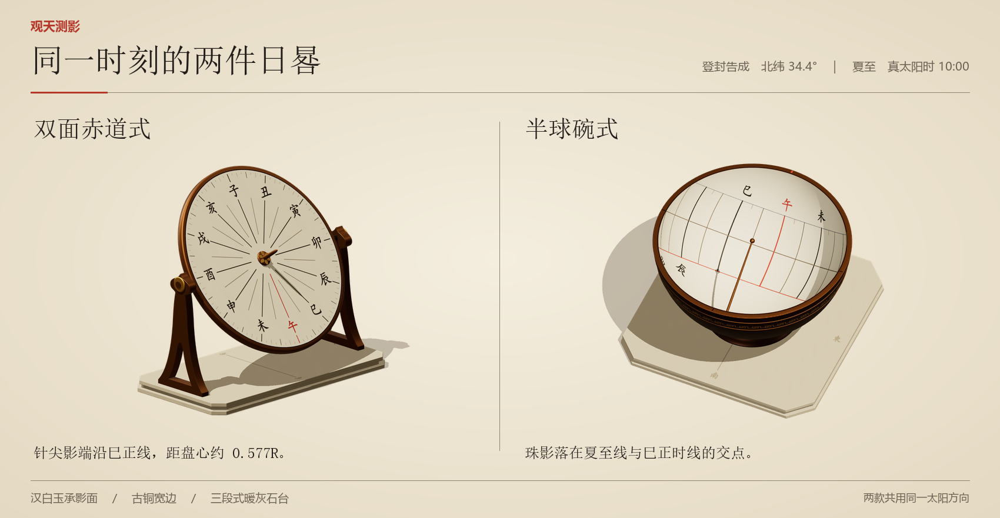
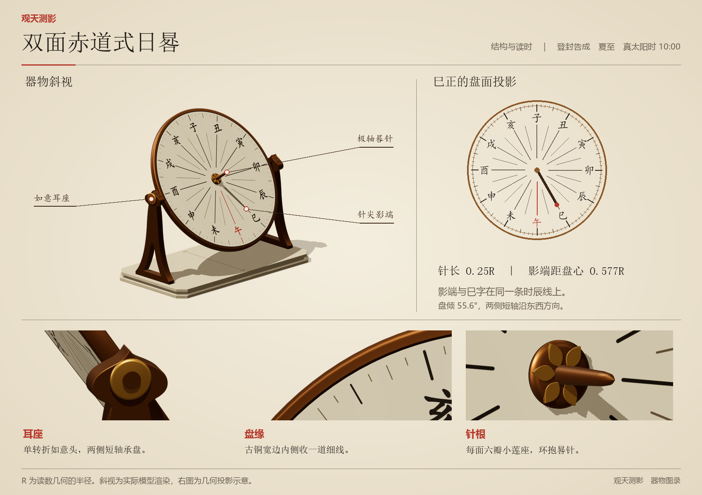
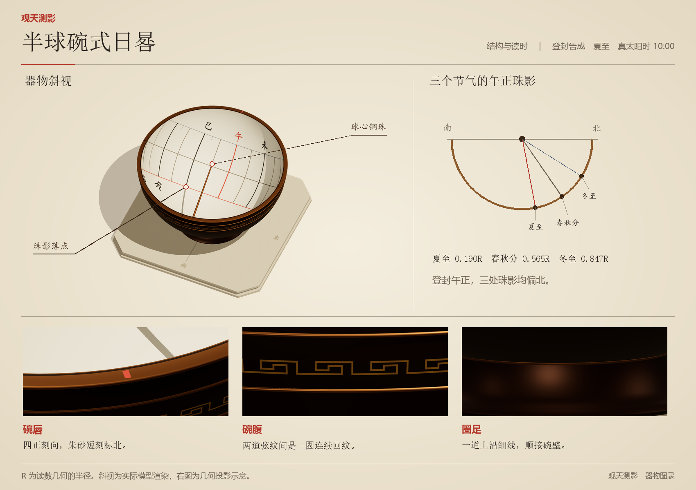

# 观天测影 · 双日晷建模与切换方案

观测页同屏提供 **赤道式** 和 **碗式** 两个切换按钮。选定登封告成、夏至、真太阳时 10:00 后，两件器物都读作巳正。赤道式看针影的方向，碗式看铜珠影落在哪条时线与节气线的交点。网页版与下列图版取自同一套三维模型。

## 从旧试模到成套器物

旧试模的石台、铜耳和碗外壁在侧光下偏灰绿。新版把最大的两块面积分别留给宣纸和汉白玉，古铜集中在承重、收边和投影部件上。赤道式仍以悬盘的通透轮廓为主，碗式以仰口、收腹、圈足的连续曲线为主。两者的台座、铜边和刻字采用相同尺寸规则。首页圆心的水平日晷属于另一处展示。

| 共用项目 | 制作规格 |
| --- | --- |
| 比例与石台 | 产品半径 R = 5 个场景单位。下枋、束腰、上枋各高 0.04R，边缘倒角 0.004R。其余线脚分 0.01R、0.02R、0.04R 三档。台身留圭角，台面只刻南北基线与四正。 |
| 铜边 | 同一宽边截面语言，径向边宽以 0.048R 为基准，内侧一道 0.007R 细线。极短的铜绿只在近景内缘凹槽出现。 |
| 刻线与文字 | 时辰主线、刻线、细分线的纹理线宽为 0.009、0.0055、0.003，与各自承影面的半径坐标对应。统一楷体，系统缺字时依次回退到宋体风格。午字用朱砂，其余时辰字用墨。 |
| 远、中、近 | 远景保留主体轮廓，中景恢复刻字、线脚和方位，近景显示回纹、莲瓣与石纹。手机上限为中景，刻线加宽 20%，时辰字亦单独放大。 |

## 双面赤道式

- **盘与针**　盘外径 2R，厚 0.08R。晷针沿天极方向贯穿盘心，每面从盘面量至针尖均为 0.25R。针根配小莲座，每面六瓣。时辰主线从 0.17R 伸至 0.65R，字心在 0.749R；外环每十五分钟一划。
- **支承**　2.42R × 1.28R 长方石台托起一对镂空耳座，轴心高出台面 1.12R。耳顶为单次收放的如意形。两截短耳轴沿东西方向，内端接盘缘，外端接耳座内面。盘绕此轴适配纬度，盘下仍有通透的视线。
- **读数**　登封北纬 34.4°，晷盘与水平面夹角 55.6°。理想夏至 10:00，针尖影端距盘心约 0.577R，位于巳正线。到 11:00，针影转过 15°。理想冬至同一真太阳时改从另一面读，影长相等。分日前后影端可能越缘，赤纬为零时阳光平行盘面。 [原有投影计算](../web/src/lib/astro/sundialGeometry.js) · [赤道式结构](../web/src/scene/sundial/instrument.js) · [英国日晷学会的原理图](https://sundialsoc.org.uk/all-about-sundials/how-sundials-work/how-sundials-work-part-1/)

## 半球碗式

- **碗与圈足**　内壁是半径 R 的完整下半球，外壳半径 1.05R，碗口水平。抹角方台每边 2.26R。空心圈足从台面至接缝高 0.20R，上口与外壁共用同一个连接圆。圈足上沿一道细线。碗腹只留两道 0.01R 弦纹，中间一圈回纹落在高 0.04R 的窄带里。
- **铜珠与碗唇**　珠径 0.052R，珠心位于碗口圆心。斜杆从天极轴在下半球的一端托入，根部用小圆托收口。碗唇四正各一刻，北刻为朱砂。内壁的时辰曲线与节气曲线独立生成，常用时辰字排在夏至线、冬至线外侧的字带。
- **读数**　从碗心 C 指向太阳的单位向量为 S。太阳在地平线上方时，珠影中心 Q = C − R × S。改变真太阳时，珠影沿节气轨迹移动；固定时刻改变节气，珠影沿时线移动。春分和秋分共线。太阳降至地平线，隐藏直射珠影。 [碗式投影与刻纹几何](../web/src/lib/astro/bowlSundial.js) · [碗式结构](../web/src/scene/sundial/bowlInstrument.js) · [韩国国立古宫博物馆的半球日晷藏品](https://www.gogung.go.kr/gogungEn/pgm/psgudMng/view.do?menuNo=1000015&psgudSn=359719)

| 登封午正 | 太阳高度 | 珠影在水平面内相对碗心的偏移 |
| --- | --- | --- |
| 理想夏至 | 79.0° | 向北 0.190R |
| 春分或秋分 | 55.6° | 向北 0.565R |
| 理想冬至 | 32.2° | 向北 0.847R |

## 色板与布光

| 部位 | 颜料与材质 |
| --- | --- |
| 纸面 | 宣纸中心 `#F4EEDF`，边缘 `#E4D9C2`。结构图将透明渲染连同接地影合成到整张纸上。 |
| 承影面和台座 | 汉白玉 `#EEE7D6`，粗糙度 0.60，近景石纹法线强度 0.12。台座 `#BDB3A1`，台面刻线 `#8F8573`。 |
| 古铜和漆铜 | 基色 `#8C5A2B`、亮部 `#D6A24A`、暗部 `#3A2515`，金属度 0.85，粗糙度 0.34–0.45。碗外壁 `#43291A`。 |
| 字与刻线 | 墨 `#231D19`，淡墨 `#6E6254`，朱砂 `#B5382B`。靛蓝 `#34506E` 用在冬至细线；铜绿 `#6B8573` 用在铜槽。 |
| 光源与落影 | 主光 `#FFF0D2` 沿原太阳向量。半球补光天色 `#FFF7E8`、地色 `#D9CBB1`，强度最高 0.16。暖色室内环境经过预滤波供古铜反射。ACES Filmic 曝光 1.0；接地影 `#4A3826`，日照时不透明度 0.28，边缘按遮挡距离柔化。 |

网页、二维模式和三维场景共用同一份色板。 [集中色板](../web/src/scene/sundial/sundialTheme.js) · [环境与光源](../web/src/scene/sundial/stage.js) · [台座和铜边](../web/src/scene/sundial/instrumentCraft.js)

## 切换与验收

在“观天测影”标题下方切换器型，时间、地点、播放和节气选择继续沿用。读数面板在赤道式显示受光面和影长比，在碗式显示珠影的水平偏移。光影关系、天球与二至对照可按需开启。旧观测链接默认打开赤道式，带 `dial=bowl` 的链接直接打开碗式。二维显示同步选择的器型。图版采用理想夏至赤纬 +23.44°；网页使用所选地点日期的实际太阳位置。 [观测页](../web/src/components/SundialView.vue) · [观测数据](../web/src/lib/astro/observation.js)

[赤道式斜视前后](验收图/赤道式斜视_前后对比.png) · [碗式斜视前后](验收图/碗式斜视_前后对比.png) · [390px 手机前后](验收图/390px手机_前后对比.png) · [两款三视轮廓](验收图/两款日晷_三视轮廓.png) · [验收测量与截图口径](验收图/验收说明.md)
