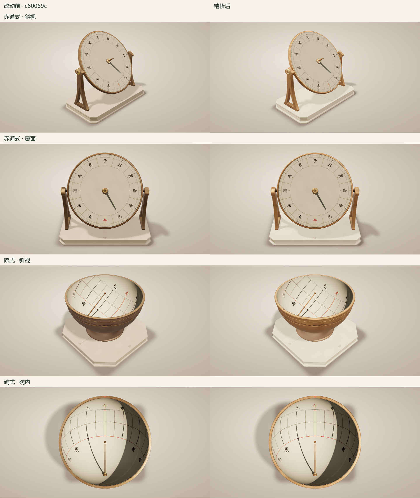

# 双日晷材质与观测交互验收 · 2026-11-19

在桌面 Chrome 中从授时项目的观测页加载 Three.js，分别检查双面赤道式和半球碗式。铜边和外壁使用不同粗糙度，暖白石座保留束腰与底沿。当天太阳方向、针长、球心和承影面的计算沿用原模型。

## 同机位复拍

登封告成，2026-06-21，真太阳时 10:00。1440×900 桌面视口，关闭光线、影端标记和方位辅助。下图保留画布原始像素，同一行依次为基线 `c60069c` 与本轮成品。另看了碗内午正的珠影和 2026-12-22 上午赤道晷背面的针影。

## 手机模拟影端对比度

使用 Chrome 390×844 触屏模拟，设备像素比为 1。以真实影端为圆心，在半径 4 CSS 像素圆内取样。对同一机位开、关太阳投影分别截图，将 sRGB 转为线性亮度，逐像素计算（关影亮度＋0.05）／（开影亮度＋0.05），取第 95 百分位。表中为本机本轮基线与成品实测值。

| 机位 | 改动前 | 本轮成品 |
| --- | ---: | ---: |
| 赤道式，晷面正视的针影 | 4.93∶1 | 5.18∶1 |
| 碗式，斜视的珠影 | 7.45∶1 | 7.47∶1 |

## 交互与读数

- **桌面 1366×768。** 从画框上沿展开天球，播放、暂停并用日轴键盘逐分钟调整。午夜背景呈浅青灰，回看日晷恢复展台纸色。二至表在桌面侧栏显示，切换驱动节气、播放和暂停时仍显示两日读数。[二至侧视与读数](笔记本二至对照.png)
- **二至边界。** 在真太阳时 05:00 查到夏至八尺表影长 278.03 尺，冬至无直射影，表中差值显示为横线。午夜两日均无直射影，午正恢复两列数值。夏至与冬至分别使用朱红、青蓝，长影在场景边界保留截断箭头，表格给出计算全长。
- **手机 390×844。** 在减少动态效果下复查天球、日轴、播放和读数。通过浏览器触摸事件实测画布旋转、恢复纵向滚动、横向拨尺。宽窄屏之间往返时，同一张二至表在侧栏和画布下方切换。[午夜天球与日轴](手机午夜天球.png) · [二至读数](手机二至对照.png)
- **二维回退。** 实测手动切换二维并恢复三维，另在禁用 WebGL 的浏览器中验证自动回退，可切换两款 SVG 器型、查看二至读数。
- **工程与设备。** 五个阶段均通过 65 项自动化测试和生产构建。Vite 仍提示部分分块超过 500 kB。以上画面和交互结果取自本机浏览器；比赛笔记本、物理手机与现场投影仍待实测。
